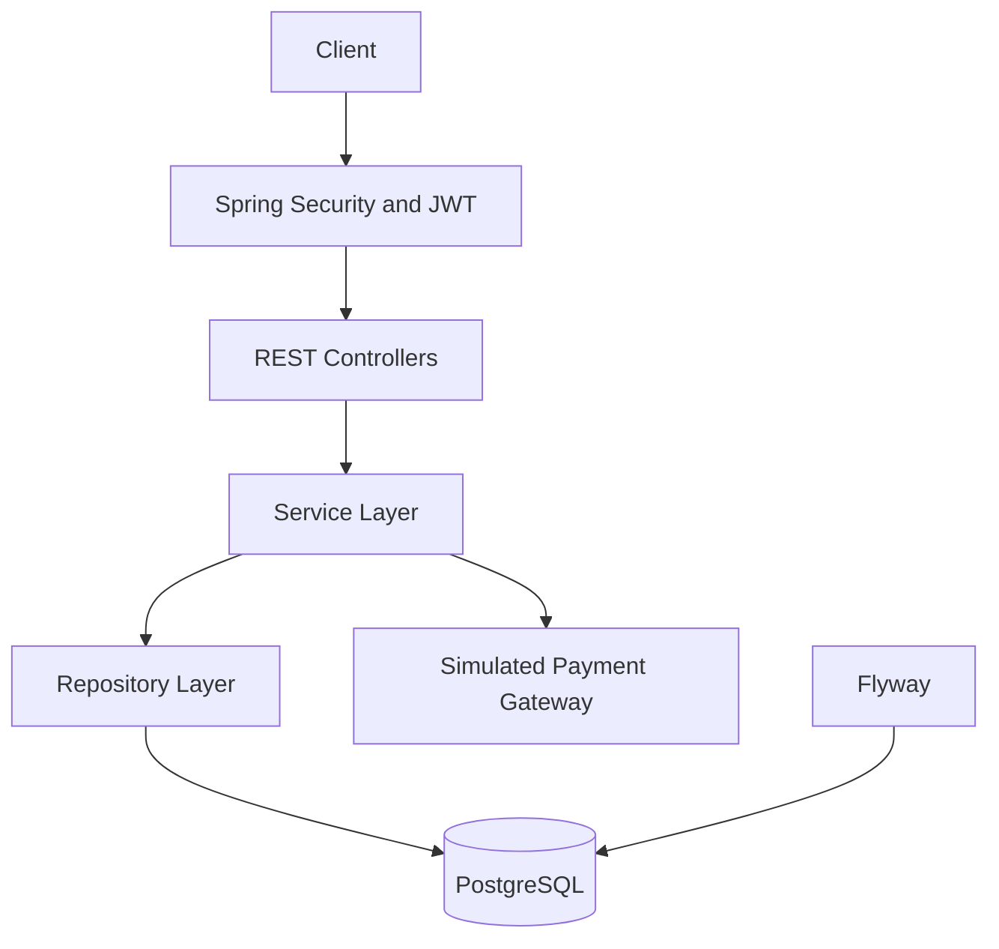

Bookworm – eCommerce Backend

A RESTful eCommerce backend for an online bookstore, built with Java 21, Spring Boot, Spring Security, PostgreSQL and Hibernate.

Bookworm provides a complete backend foundation for an online bookstore, including catalogue discovery, authentication, administrative catalogue management, cart and wishlist management, checkout, order lifecycle management, simulated payments and loyalty points.

---

Features

Catalogue
- Browse and search books.
- Filter books by category.
- Retrieve book details.
- Related-book functionality.

Authentication & Security
- User registration and login.
- JWT-based stateless authentication.
- BCrypt password hashing.
- Failed-login lockout.
- Password change functionality.
- Role-based authorization for customers and administrators.

Admin Catalogue Management
- Create and manage book records.
- Activate and deactivate books.
- Request validation.
- Optimistic locking for concurrent modifications.

Cart
- Add books to cart.
- Update quantities.
- Remove individual items.
- Clear cart.
- Stock validation.
- Live-price-based calculations.
- Cart availability indicators.

Wishlist
- Add and remove wishlist items.
- View wishlist.
- Move books between wishlist and cart.
- Duplicate prevention.
- Ownership validation.

Checkout & Orders
- Checkout with shipping details.
- Order and order-item snapshots.
- Simulated payment gateway.
- Idempotent checkout.
- Customer order history.
- Administrative order management.
- Order status transitions.
- Cancellation with stock restoration and simulated refund handling.
- Order status audit history.

Loyalty
- Persistent points balance.
- Transactional loyalty ledger.
- Points redemption during checkout.
- Redemption capped at 20% of order subtotal.
- Points earned upon eligible delivery.
- Points restoration on eligible cancellation.
- Points balance and transaction history APIs.

---

Technology Stack

| Technology | Version / Usage |
|---|---|
| Java | 21 |
| Spring Boot | 4.1.2 |
| Spring Security | 7 |
| PostgreSQL | 18 |
| Hibernate | 7 |
| JWT | HS256 |
| Password Encoding | BCrypt / Delegating Password Encoder |
| Flyway | Database migrations |
| Maven | Build and dependency management |
| JUnit | Testing |
| Mockito | Mocking and unit tests |

---

Architecture

Bookworm follows a layered architecture.



 Layers

- **Security Layer:** Authentication, JWT validation and role-based authorization.
- **Controller Layer:** REST API endpoints and request/response handling.
- **Service Layer:** Business logic, validation, transaction management and orchestration.
- **Repository Layer:** Persistence operations using Spring Data JPA.
- **Database Layer:** PostgreSQL persistence and Flyway schema migrations.

---

Prerequisites

Install the following before running Bookworm:

- Java 21
- Maven
- PostgreSQL 18
- Git

Verify installations:

```bash
java -version
mvn -version
psql --version
git --version
```

---

 Getting Started

 1. Clone the Repository

```bash
git clone <repository-url>
cd bookworm-ecommerce-backend
```

Replace `<repository-url>` with the actual repository URL.

 2. Create the PostgreSQL Database

Create a dedicated local development database.

```sql
CREATE DATABASE bookworm_db;
```

Create a database user if required:

```sql
CREATE USER bookworm_user WITH PASSWORD 'your_local_password';

GRANT ALL PRIVILEGES ON DATABASE bookworm_db TO bookworm_user;
```

Connect to the database and grant schema permissions if required by your PostgreSQL configuration:

```sql
\c bookworm_db

GRANT ALL ON SCHEMA public TO bookworm_user;
```

Use a separate database for integration testing. Never use the development database for automated integration tests.

 3. Configure Environment Variables

Configure the application using environment variables.

| Variable | Description | Example |
|---|---|---|
| `DB_URL` | PostgreSQL JDBC URL | `jdbc:postgresql://localhost:5432/bookworm_db` |
| `DB_USERNAME` | Database username | `bookworm_user` |
| `DB_PASSWORD` | Database password | Local password |
| `JWT_SECRET` | JWT signing secret | Secure secret |
| `JWT_EXPIRATION` | JWT expiration configuration | Use configured application value |

Example configuration for PowerShell:

```powershell
$env:DB_URL="jdbc:postgresql://localhost:5432/bookworm_db"
$env:DB_USERNAME="bookworm_user"
$env:DB_PASSWORD="your_local_password"
$env:JWT_SECRET="replace-with-a-secure-secret"
```

> Environment variable names above should match the application's actual configuration placeholders. Confirm them against `application.yml` or `application.properties` before running.

For a production environment, use a secure secrets manager or environment-based secret injection. Do not hardcode credentials or commit secrets.

 4. Run the Application

From the project root:

```bash
mvn spring-boot:run
```

Alternatively, build the application:

```bash
mvn clean package
```

Run the generated JAR:

```bash
java -jar target/<application-jar>.jar
```

Replace the JAR filename with the one generated by Maven.

The application will connect to PostgreSQL and apply configured Flyway migrations during startup, if migration execution is enabled in the application configuration.

---

 Database Migrations

Bookworm uses Flyway for database schema versioning.

Migrations are maintained under:

```text
src/main/resources/db/migration/
```

Reported feature migrations:

| Migration | Description |
|---|---|
| V5 | Cart and Wishlist |
| V6 | Orders and Checkout |
| V7 | Loyalty |

Earlier migrations establish the base schema and other core features.

Flyway applies migrations sequentially according to the configured database and migration settings.

Do not manually modify an already-applied migration. Create a new migration for subsequent schema changes.

---

 API Overview

The following endpoints represent the functional API areas. Confirm exact endpoint paths, request fields and response structures against the controllers before using them as an API contract.

| Module | API area |
|---|---|
| Authentication | `/api/v1/auth/**` |
| Catalogue | `/api/v1/books/**` |
| Admin Catalogue | `/api/v1/admin/**` |
| Customer Cart | `/api/v1/me/cart/**` |
| Customer Wishlist | `/api/v1/me/wishlist/**` |
| Customer Orders | `/api/v1/me/orders/**` |
| Admin Orders | `/api/v1/admin/orders/**` |
| Customer Loyalty | `/api/v1/me/points` |

---

 API Examples

 Authentication

 Register

```http
POST /api/v1/auth/register
Content-Type: application/json
```

Example request:

```json
{
  "name": "Bookworm User",
  "email": "user@example.com",
  "password": "SecurePassword123"
}
```

> The request fields shown are illustrative. Verify the exact registration DTO in the code.

 Login

```http
POST /api/v1/auth/login
Content-Type: application/json
```

Example request:

```json
{
  "email": "user@example.com",
  "password": "SecurePassword123"
}
```

A successful login returns authentication information according to the implemented response contract.

Use the returned JWT for authenticated requests.

---

 Catalogue

 Search Books

```http
GET /api/v1/books
```

Example search:

```http
GET /api/v1/books?q=java
```

Example category filter:

```http
GET /api/v1/books?category=programming
```

The exact query parameters and supported filters depend on the catalogue controller implementation.

---

 Cart

 Retrieve Cart

```http
GET /api/v1/me/cart
Authorization: Bearer <JWT>
```

 Add a Book

```http
POST /api/v1/me/cart/items
Authorization: Bearer <JWT>
Content-Type: application/json
```

Example request:

```json
{
  "bookId": 1,
  "quantity": 2
}
```

 Update Cart Item

```http
PUT /api/v1/me/cart/items/{bookId}
Authorization: Bearer <JWT>
Content-Type: application/json
```

Example request:

```json
{
  "quantity": 3
}
```

 Remove Cart Item

```http
DELETE /api/v1/me/cart/items/{bookId}
Authorization: Bearer <JWT>
```

 Clear Cart

```http
DELETE /api/v1/me/cart
Authorization: Bearer <JWT>
```

---

 Wishlist

 Retrieve Wishlist

```http
GET /api/v1/me/wishlist
Authorization: Bearer <JWT>
```

 Add Wishlist Item

```http
POST /api/v1/me/wishlist/items
Authorization: Bearer <JWT>
Content-Type: application/json
```

Example request:

```json
{
  "bookId": 1
}
```

 Remove Wishlist Item

```http
DELETE /api/v1/me/wishlist/items/{bookId}
Authorization: Bearer <JWT>
```

---

 Checkout

 Create Order

```http
POST /api/v1/me/orders
Authorization: Bearer <JWT>
Content-Type: application/json
Idempotency-Key: checkout-001
```

Example request:

```json
{
  "shippingAddress": {
    "name": "Bookworm User",
    "phone": "9876543210",
    "addressLine1": "123 Main Street",
    "city": "Delhi",
    "state": "Delhi",
    "postalCode": "110001"
  },
  "paymentToken": "tok_success",
  "pointsToRedeem": 0
}
```

> Confirm the exact DTO fields against `CheckoutRequest` and `ShippingAddressDto`. The example reflects the reported checkout design.

 Simulated Payment Tokens

The checkout implementation includes a simulated payment gateway.

| Token | Simulated outcome |
|---|---|
| `tok_success` | Successful payment |
| `tok_declined` | Payment declined |
| `tok_error` | Simulated payment gateway failure |

These tokens are for development and testing purposes only. They are not real payment credentials.

 Idempotency

Checkout requests require an idempotency key.

```http
Idempotency-Key: checkout-001
```

Idempotency is designed to prevent duplicate order processing when a checkout request is retried.

---

 Orders

 Retrieve Customer Order

```http
GET /api/v1/me/orders/{orderNumber}
Authorization: Bearer <JWT>
```

 Retrieve Customer Order History

```http
GET /api/v1/me/orders
Authorization: Bearer <JWT>
```

Example pagination:

```http
GET /api/v1/me/orders?page=0&size=10
Authorization: Bearer <JWT>
```

 Cancel Order

```http
POST /api/v1/me/orders/{orderNumber}/cancel
Authorization: Bearer <JWT>
```

Cancellation is subject to the implemented order status rules.

---

 Admin Order Management

Admin APIs require appropriate administrative authorization.

 List Orders

```http
GET /api/v1/admin/orders
Authorization: Bearer <ADMIN_JWT>
```

 Retrieve Order

```http
GET /api/v1/admin/orders/{orderNumber}
Authorization: Bearer <ADMIN_JWT>
```

 Update Order Status

```http
PATCH /api/v1/admin/orders/{orderNumber}/status
Authorization: Bearer <ADMIN_JWT>
Content-Type: application/json
```

Example request:

```json
{
  "status": "PROCESSING"
}
```

Verify the exact DTO and supported transition rules in the implementation.

---

 Loyalty

 Retrieve Loyalty Balance and Transactions

```http
GET /api/v1/me/points
Authorization: Bearer <JWT>
```

The endpoint provides the customer's loyalty balance and paginated transaction history according to the implemented API contract.

 Loyalty Rules

- Points may be redeemed during checkout.
- Redemption is capped at 20% of the order subtotal.
- Eligible orders earn points upon delivery.
- Eligible cancellation handling restores previously redeemed points.
- Ledger transactions provide an audit trail.

---

Authentication and Authorization

Bookworm uses stateless JWT authentication.

Authenticated endpoints require:

```http
Authorization: Bearer <JWT>
```

 Roles

| Role | Permissions |
|---|---|
| CUSTOMER | Customer catalogue interactions, cart, wishlist, checkout, customer orders and loyalty |
| ADMIN | Administrative catalogue management and order management |

Customers are restricted to their own resources through the application's authorization and ownership validation mechanisms.

---

 Testing

Bookworm uses unit, slice and integration testing.

 Unit and Slice Tests

Test service logic, request validation, controller behavior, security and error handling using JUnit and Mockito.

Run tests:

```bash
mvn test
```

 Integration Tests

Integration tests require a dedicated PostgreSQL test database.

Do not run integration tests against the development database.

The project uses a dedicated `bookworm_test` database in the reported integration-testing setup.

Integration tests should clean up test-created records.

 Test Scope

- Catalogue tests.
- Authentication tests.
- Admin catalogue tests.
- Cart tests.
- Wishlist tests.
- Checkout tests.
- Order lifecycle tests.
- Loyalty tests.
- Security and error handling tests.

---

 Project Structure

The following is a representative structure based on the implemented modules. Exact filenames may vary.

```text
bookworm-ecommerce-backend/
│
├── src/
│   ├── main/
│   │   ├── java/com/bookworm/
│   │   │   ├── auth/
│   │   │   ├── catalogue/
│   │   │   ├── cart/
│   │   │   ├── wishlist/
│   │   │   ├── order/
│   │   │   ├── loyalty/
│   │   │   ├── user/
│   │   │   ├── common/
│   │   │   │   ├── error/
│   │   │   │   ├── security/
│   │   │   │   └── web/
│   │   │   └── ...
│   │   │
│   │   └── resources/
│   │       ├── application.yml
│   │       └── db/
│   │           └── migration/
│   │               ├── V1__...
│   │               ├── V2__...
│   │               ├── V3__...
│   │               ├── V4__...
│   │               ├── V5__cart_and_wishlist.sql
│   │               ├── V6__orders_and_checkout.sql
│   │               └── V7__loyalty.sql
│   │
│   └── test/
│       └── java/com/bookworm/
│           ├── auth/
│           ├── catalogue/
│           ├── cart/
│           ├── wishlist/
│           ├── order/
│           ├── loyalty/
│           └── ...
│
├── docs/
│   └── DESIGN.md
│
├── pom.xml
├── AGENTS.md
└── README.md
```

---

 Development Guidelines

- Keep business logic within service layers.
- Use DTOs rather than exposing persistence entities directly.
- Validate incoming requests.
- Enforce ownership and role-based access.
- Use transactional operations for critical business workflows.
- Use atomic database operations for stock and points updates.
- Use idempotency for retry-sensitive operations.
- Use Flyway for schema changes.
- Do not commit credentials or secrets.
- Use dedicated test databases.
- Avoid modifying applied migrations.

---

 Limitations

- Payment processing is simulated and does not integrate with a real payment provider.
- The backend requires PostgreSQL.
- Integration test execution requires a separate test database.
- Full production deployment configuration, infrastructure, observability and payment-provider integration may require additional implementation.

---

 Project Status

Phases 1–7 of the Bookworm backend have been reported as implemented:

1. Catalogue
2. Authentication
3. Admin Catalogue
4. Cart and Wishlist
5. Checkout and Order Lifecycle
6. Loyalty
7. Final Hardening

The project is currently at the implementation and verification stage, with final database integration verification and submission preparation recommended.

---

 License

Specify the project's license here before publishing or distributing the repository.
