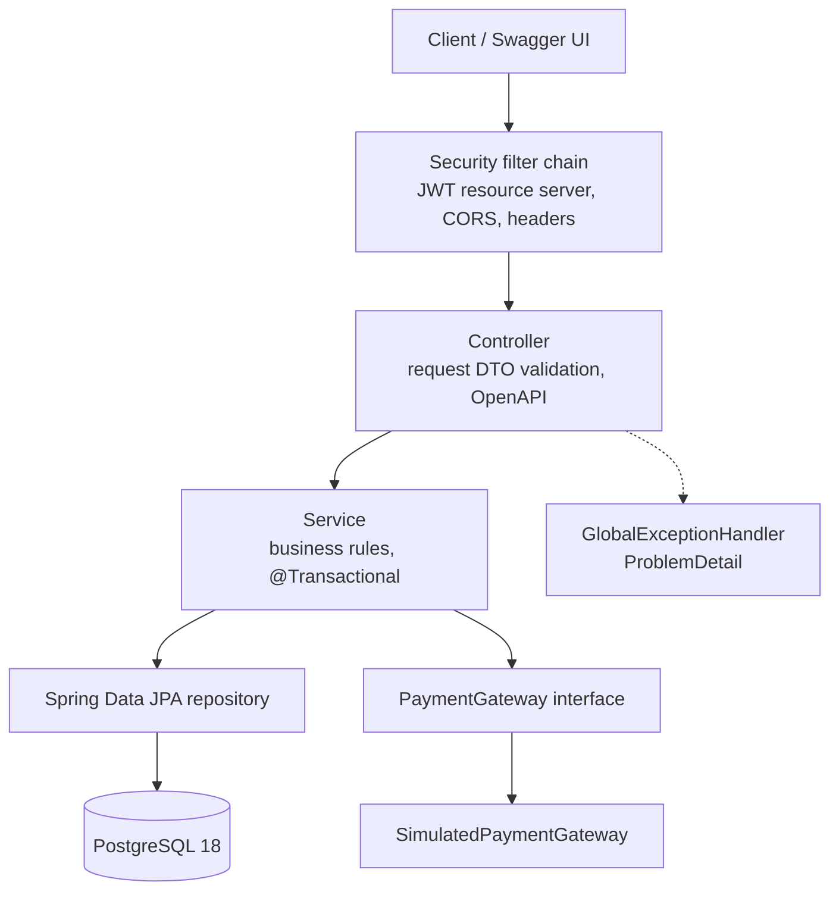
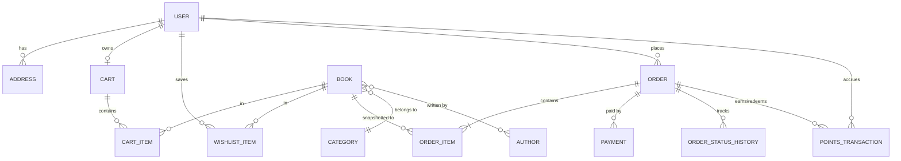
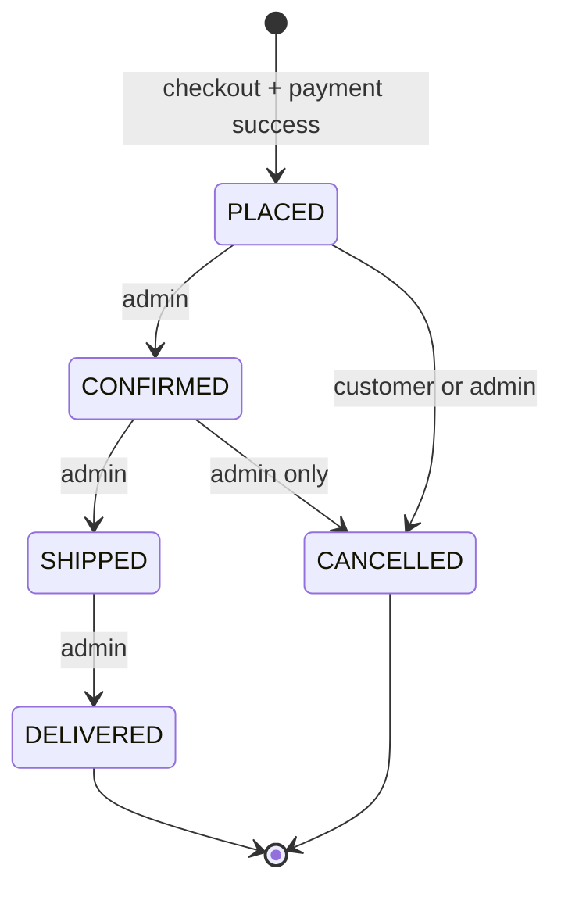

# BookWorm Backend: Design (Phase 0 baseline, kept current through Phase 4 planning)

Status: Phases 0, 1, 2 and 3 are done, reviewed, committed and pushed (Phase 3 is commit `32d0d59`). Phase 4 (shopping cart and wishlist) has an owner-approved design in "Phase 4 scope" (section 8) but **no application implementation and no test yet**. Milestone M1 has created the migration file `V5__cart_and_wishlist.sql`; it has **not been executed or applied to any database** and is pending owner review. This document is the design that Phases 4-10 follow. All twelve design decisions below are confirmed by the project owner; the authentication choice remains a policy deviation that is **not approved** (section 7).

## 1. Decisions

| # | Decision | Status |
|---|---|---|
| 1 | Self-contained authentication: Spring Security, JWT, BCrypt. Registration and login. No Keycloak or external IdP. | Design confirmed by owner; deviation from the SAML/OIDC policy **not approved** (section 7) |
| 2 | All cart operations require an authenticated customer. No guest carts, no cart merging. | Confirmed |
| 3 | Minimal Admin API for books and catalogue data, protected by role-based authorization. Initial catalogue from seed data. | Confirmed |
| 4 | Order lifecycle: PLACED, CONFIRMED, SHIPPED, DELIVERED, CANCELLED, with validated transitions. | Confirmed |
| 5 | Loyalty: 1 point per Rs 100 spent; 100 points = Rs 10 discount; redemption capped at 20% of order value; rules configurable. | Confirmed |
| 6 | Physical store: customer shipping addresses, with a snapshot of the address stored on each order. | Confirmed |
| 7 | Java 21, PostgreSQL, latest stable compatible Spring Boot (verified: 4.1.2). | Confirmed |
| 8 | Points are credited when an order is DELIVERED, not at purchase. | Confirmed |
| 9 | Prices are tax-inclusive, no shipping fee, INR only. | Confirmed |
| 10 | Points earned are based on the amount actually paid, after the points discount. | Confirmed |
| 11 | Stock is held on the `books` table (no separate inventory table). | Confirmed |
| 12 | No refresh tokens (out of scope); short-lived access token (default 60 min). | Confirmed |

### Security policy deviation (decision 1)
The organisation's security rules require SAML or OpenID Connect for user authentication. The project owner chose self-contained login (Spring Security, JWT, BCrypt) with no external identity provider. That is a design choice; **it is not an approved policy exception, and this document does not claim that it is.** Status, compensating controls and the limitations of the design are in section 7 ("Authentication policy deviation: status and limitations").

## 2. Toolchain verification (done in Phase 0)

| Item | Version | Note |
|---|---|---|
| Spring Boot | 4.1.2 | Latest GA on Maven Central. `4.2.0-RC2` excluded (release candidate). |
| springdoc-openapi | 3.2.0 | Its parent is Boot 4.1.2. |
| Managed by Boot 4.1.2 | Spring Framework 7.0.10, Spring Security 7.1.2, Hibernate 7.4.13, PostgreSQL driver 42.7.14, Flyway 12.4.0, Jackson 3, JUnit 6.0.3 | Boot-managed versions are used as-is. |
| JWT | Spring Security Nimbus resource-server support | `jjwt` not used: it targets Jackson 2 and Boot 4 uses Jackson 3. |
| Java | 21 (Temurin 21.0.13) | The Boot parent defaults to 17; `java.version` is set to 21. |
| Maven | 3.10.1 | |
| PostgreSQL | 18.7, local, port 5432 | Docker is not available, so tests use a real local database, not Testcontainers or H2. |

## 3. Architecture

Single Spring Boot application, package-by-feature, strict layering. No microservices.



```
com.bookworm
 |- common     error handling, config, web filters, security config, paging
 |- auth       register, login, token issuing, lockout
 |- user       User, Address, profile
 |- catalogue  Book, Author, Category, search, related books, admin CRUD
 |- cart
 |- wishlist
 |- order      Order, OrderItem, status history, state machine, checkout
 |- payment    Payment, gateway interface, simulator
 |- loyalty    PointsTransaction, rules, calculator
```

Rules:
- `controller -> service -> repository`. Controllers never touch repositories.
- A feature uses another feature only through its service.
- Entities never leave the service layer. Requests and responses are Java records with hand-written mappers (no Lombok, no MapStruct).
- `order` orchestrates checkout (cart, stock, loyalty, payment) in one transaction.

| Concern | Decision |
|---|---|
| Money | `BigDecimal`, `NUMERIC(12,2)`, INR, `HALF_UP`. |
| Schema | Flyway versioned migrations; `ddl-auto=validate`. |
| Seed data | Separate Flyway location `db/seed`, dev profile only. Never in `db/migration`. |
| Concurrency | Atomic conditional stock update in id order, cart and order row locks, conditional points update. Full design: "Checkout, stock concurrency and idempotency" in section 4. |
| Idempotency | Required `Idempotency-Key` header on checkout; advisory lock plus unique (user, key) plus request fingerprint; a replay returns the original order. Full design in section 4. |
| Order numbers | `BW-YYYYMMDD-` + 6 random chars from `SecureRandom` (not enumerable). |
| Errors | One `@RestControllerAdvice`, RFC 9457 `ProblemDetail` with stable `code` and `traceId`. |
| Profiles | `dev`, `test`, `prod`. Secrets only from environment variables. |
| Binding | `server.address=127.0.0.1`. |
| Database safety | Only the application's Flyway migrations change schema. The assistant never creates, renames, drops or otherwise modifies a database or role on the owner's server without the owner's explicit approval; checks against the server are read-only. |

## 4. Domain model



| Entity (table) | Main fields | Constraints and notes |
|---|---|---|
| User (`users`) | id, email, passwordHash (BCrypt), firstName, lastName, phone, role (CUSTOMER/ADMIN), enabled, failedLoginAttempts, lockedUntil, pointsBalance, createdAt | Email unique, stored lowercase. Registration always yields CUSTOMER. First admin comes from environment variables, never a default password. |
| Address (`addresses`) | id, userId, recipientName, phone, line1, line2, city, state, postalCode, country, isDefault | One default per user. PIN is 6 digits. Max 10 per user. |
| Category | id, name, slug | Both unique. Flat. |
| Author | id, name | Created from names in the admin book request. |
| Book | id, isbn, title, description, price, publisher, publishedDate, coverUrl, categoryId, stockQuantity, active, version | ISBN unique. Authors via join table. Soft delete (`active=false`) keeps history valid. |
| Cart / CartItem (`carts`, `cart_items`) | Cart: id, userId (unique), version, createdAt, updatedAt. Item: id, cartId, bookId, quantity (1-10), createdAt, updatedAt | Unique (cartId, bookId). No price stored; always read live. Schema in `V5__cart_and_wishlist.sql` (file created in M1, not yet applied to any database) and rules: "Phase 4 scope" in section 8. |
| WishlistItem (`wishlist_items`) | id, userId, bookId, addedAt | Unique (userId, bookId). Max 200 per user. See "Phase 4 scope". |
| Order (`orders`) | id, orderNumber (unique), userId, status, subtotal, pointsRedeemed, pointsDiscount, total, pointsEarned, shipping address snapshot (embedded columns), idempotencyKey, requestFingerprint, version, createdAt, updatedAt | Unique (userId, idempotencyKey). `pointsEarned` is fixed at checkout and credited on DELIVERED. The snapshot copies address fields and has **no foreign key** to `addresses`. |
| OrderItem | id, orderId, bookId, isbnSnapshot, titleSnapshot, unitPrice, quantity, lineTotal | Immutable. |
| OrderStatusHistory | id, orderId, fromStatus, toStatus, changedBy, reason, changedAt | Audit trail. |
| Payment | id, orderId, amount, status (SUCCEEDED/REFUNDED), gatewayReference, createdAt | No card data stored. |
| PointsTransaction | id, userId, orderId, type (REDEEM/EARN/RESTORE), points (signed), createdAt | Append-only ledger. `users.pointsBalance` is a cached sum updated in the same transaction. Unique (orderId, type) so each happens once per order. `REVERSE_EARN` is reserved and not created (see Loyalty). |

Indexes: `pg_trgm` GIN on `books.title` and `authors.name` (Phase 1); B-tree on `books.category_id`, `orders(user_id, created_at)`, `orders(status)`.

### Order lifecycle



| From | Allowed to | Who |
|---|---|---|
| PLACED | CONFIRMED | Admin |
| PLACED | CANCELLED | Customer (owner) or admin |
| CONFIRMED | SHIPPED | Admin |
| CONFIRMED | CANCELLED | Admin only |
| SHIPPED | DELIVERED | Admin |
| DELIVERED, CANCELLED | none (terminal) | none |

Any other transition returns 409 `INVALID_STATUS_TRANSITION`. The transition table lives in the `OrderStatus` enum and is tested exhaustively.

Side effects: **cancel** restores stock and redeemed points and marks the payment REFUNDED. **Delivered** credits earned points (decision 8). Payment is not an order state: if simulated payment fails, the checkout transaction rolls back, no order is created, and the API returns 402 `PAYMENT_DECLINED`.

### Checkout, stock concurrency and idempotency

Goal: never oversell, never create a duplicate order, never leave a partially committed order. This is the design Phase 7 implements; Phase 1 contains none of it.

**Stock (prevents overselling)**
- Stock lives in `books.stock_quantity`, with `CHECK (stock_quantity >= 0)` as the last line of defence.
- Decrement is one atomic conditional statement per book, never read-then-write:
  `UPDATE books SET stock_quantity = stock_quantity - :q, version = version + 1 WHERE id = :id AND active = true AND stock_quantity >= :q`.
  PostgreSQL (default READ COMMITTED) locks the row on update. A concurrent buyer waits, then re-evaluates the `WHERE` clause against the committed value, so two buyers of the last copy cannot both succeed. Zero rows updated means 409 `INSUFFICIENT_STOCK` (or `BOOK_UNAVAILABLE` if the book became inactive).
- Books are always updated in ascending `id` order, so two checkouts with overlapping carts cannot deadlock. A deadlock or lock-timeout that still happens is mapped to 409 `CONCURRENT_UPDATE` and the client may retry.
- `/me/cart` and `/me/orders/preview` never reserve stock. They are advisory; checkout re-validates everything.
- Cancel restores stock with `stock_quantity = stock_quantity + :q` inside the cancel transaction.

**Checkout transaction (one `@Transactional` boundary, all-or-nothing)**
1. Require the `Idempotency-Key` header (1-64 characters from `A-Z a-z 0-9 _ -`); otherwise 400.
2. Take a transaction-scoped advisory lock on `hash(userId, key)` (`pg_advisory_xact_lock`) so concurrent requests with the same key run one after the other.
3. Look up an existing order for `(userId, key)`. If found, compare the request fingerprint: a SHA-256 hash of the request body fields `addressId`, `redeemPoints` and `paymentToken` (the cart contents are deliberately not part of it, because the cart is emptied by the first successful attempt). If it matches, return the stored order unchanged with HTTP 200 and an `Idempotent-Replay: true` header; if it differs, return 422 `IDEMPOTENCY_KEY_REUSED`. Only the hash is stored, never the raw payment token.
4. Lock the user's cart row (`SELECT ... FOR UPDATE`), which serialises two checkouts of the same cart that use different keys; the second then sees an empty cart and gets 422 `CART_EMPTY`.
5. Load the address (must belong to the caller, else 404) and copy its fields into the order snapshot.
6. Load the books in id order, require them active, read current prices, compute `subtotal`.
7. Validate and compute points redemption (see Loyalty).
8. Decrement stock per book (atomic statement above). Deduct points (conditional update above) and write the `REDEEM` ledger row.
9. Insert `orders` (status PLACED), `order_items`, and the first `order_status_history` row.
10. Call the `PaymentGateway` with the order number as reference. `tok_declined` raises 402 `PAYMENT_DECLINED`; `tok_error` raises 502 `PAYMENT_UNAVAILABLE`. Any exception rolls back steps 8-9 completely. On success insert the `payments` row (SUCCEEDED).
11. Delete the cart items. Commit.
12. After commit only: publish the confirmation event (a logged "notification sent" stub). A failure there cannot undo or alter the order.

**Why no partial order can be committed**
- Steps 8-11 are in a single database transaction. Declined payment, gateway failure, insufficient stock, a failed points deduction, any unexpected exception, or a crash before commit all roll back stock, points, order rows and payment together. The cart is untouched on failure.
- The unique constraint on `orders(user_id, idempotency_key)` is the backstop if the lock in step 2 were ever bypassed; a violation is handled by re-reading and returning the existing order.
- Keys are recorded only on success. Retrying a declined or failed checkout with the same key is therefore a fresh attempt, not a replay.
- If the client times out after the server committed, retrying with the same key returns the original order instead of creating a second one.

**Known limitations of this design (accepted for the capstone)**
- The simulated gateway runs in-process, so rolling back the database also "undoes" the payment. A real external gateway would not roll back; it would need a payment-intent record, the idempotency key passed to the gateway, and a reconciliation job. Holding row locks while calling a remote gateway would also be avoided. This is out of scope.
- The transaction has a timeout (default 10 seconds) so a slow request cannot hold stock row locks indefinitely.
- Lost updates on the cart itself are prevented by the row lock in step 4 and by `@Version` on `carts`. The cart endpoints (Phase 4) serialise a customer's edits with the same row lock, so two concurrent edits both succeed in turn; 409 `CONCURRENT_UPDATE` is returned only when a lock cannot be obtained (see "Phase 4 scope", concurrency).

**Order status changes and cancel**
- Cancel and every admin status change first lock the order row (`SELECT ... FOR UPDATE`; `@Version` as a second guard), then check the transition table, then apply side effects (stock restore, points restore, payment refund, ledger rows) in the same transaction. Two concurrent cancels therefore serialise: the second sees CANCELLED and gets 409 `INVALID_STATUS_TRANSITION`, and stock and points are restored exactly once.

**Tests required in Phase 7/8 (exit criteria)**
- N threads buy the last copy: exactly one order, stock 0, never negative.
- Same key sent concurrently: exactly one order, all responses identical.
- Same key with a different body: 422 `IDEMPOTENCY_KEY_REUSED`.
- Declined payment, gateway failure, and a fault injected after the stock decrement: no order row, stock unchanged, points unchanged, cart intact.
- Two concurrent cancels: stock and points restored once.
- Two checkouts with overlapping carts in opposite order: no deadlock failure.

### Loyalty rules (configurable)

```yaml
bookworm.loyalty:
  earn-points: 1
  earn-per-amount: 100.00
  redeem-points-unit: 100
  redeem-value-unit: 10.00
  max-redeem-percent: 20
```

All arithmetic uses `BigDecimal` (money, scale 2) and `long` (points). No `double` or `float` anywhere in loyalty or pricing code. The rules are read from configuration and validated at startup (all values positive, `max-redeem-percent` between 0 and 100); an invalid configuration stops the application.

**Definitions**
- `subtotal` = sum of `unitPrice x quantity` over the order lines (exact at scale 2). Because prices are tax-inclusive and there is no shipping fee (decisions 9), `subtotal` is the "order value" used for the 20% cap.
- `pointValue` = `redeem-value-unit / redeem-points-unit` = Rs 0.10 per point with the defaults.
- `total` = `subtotal - pointsDiscount` = the amount actually paid.

**Redemption (at checkout, and in `/me/orders/preview`)**
1. `maxDiscount = subtotal x max-redeem-percent / 100`, rounded **DOWN** to 2 decimals (paise).
2. `maxPointsByCap = floor(maxDiscount / pointValue)`.
3. `maxRedeemablePoints = min(user.pointsBalance, maxPointsByCap)`.
4. `redeemPoints` must be a whole number, `>= 0` and `<= maxRedeemablePoints`. Any whole number is valid; it need not be a multiple of 100 (interpretation: 100 points = Rs 10 means 1 point = Rs 0.10).
5. `pointsDiscount = redeemPoints x pointValue` (exact at scale 2 with the defaults; for other configurations the result is rounded **DOWN** to 2 decimals so the customer is never given more discount than the points are worth).
6. A request above `maxRedeemablePoints` returns 422 `POINTS_LIMIT_EXCEEDED` with the allowed maximum in the response. It is never silently clamped. Until Phase 9 ships, the maximum is 0.
7. Because the cap is 20%, `total` is always at least 80% of `subtotal`, so a payment of zero is impossible.

**Earning**
- `pointsEarned = floor(total / earn-per-amount) x earn-points` (integer division of the amount actually paid, after the points discount). The discounted portion earns nothing.
- `pointsEarned` is calculated at checkout and **stored on the order**. It is credited as an `EARN` ledger row only when the order reaches DELIVERED, using the stored value, so a later configuration change cannot alter an existing order.
- If `pointsEarned` is 0, no ledger row is written.

**Ledger and balance**
- `points_transactions` is append-only; points are signed (`REDEEM` negative, `EARN` and `RESTORE` positive). `users.points_balance` is a cache updated in the same transaction as the ledger row, and an invariant (tested): `points_balance = SUM(ledger.points)` for every user.
- `points_balance` has `CHECK (points_balance >= 0)`. Deduction uses `UPDATE users SET points_balance = points_balance - :p WHERE id = :id AND points_balance >= :p`; zero rows updated means the balance changed concurrently and the checkout fails with 422 `POINTS_LIMIT_EXCEEDED` and rolls back.
- A partial unique index on `(order_id, type)` for types `REDEEM`, `EARN` and `RESTORE` makes each of them happen at most once per order, even if two requests race.

**Cancellation and reversal**

| Event | Ledger effect | Money effect |
|---|---|---|
| Checkout with redemption | `REDEEM` (negative) | Customer pays `total` |
| Cancel from PLACED or CONFIRMED | `RESTORE` (positive) for exactly the points redeemed on that order | Payment marked REFUNDED for `total` |
| Cancel an order with no redemption | none | Payment REFUNDED |
| DELIVERED | `EARN` (positive) using the stored `pointsEarned` | none |
| Cancel after DELIVERED | not allowed (DELIVERED is terminal, 409 `INVALID_STATUS_TRANSITION`) | none |

- Points are credited only on DELIVERED, and a cancelled order can never reach DELIVERED. Therefore **no earned points exist to reverse on cancellation**, and under the confirmed lifecycle no reversal of earned points happens. The `REVERSE_EARN` ledger type is reserved for a possible future return or refund-after-delivery feature and is **never written in this scope** (it is not created in the schema's allowed values until such a feature is designed).
- Restore is exact and one-time: it returns the points redeemed on that order, whatever the configuration is now, and the unique index above blocks a second restore.
- The cancel code locks the order row first (see "Checkout, stock concurrency and idempotency"), so two concurrent cancels cannot both restore points or stock.

**Worked examples (defaults)**

| Subtotal | Balance | Requested | maxDiscount | maxRedeemable | Discount | Total paid | Earned on DELIVERED |
|---|---|---|---|---|---|---|---|
| 1000.00 | 500 | 500 | 200.00 | min(500, 2000) = 500 | 50.00 | 950.00 | 9 |
| 999.99 | 5000 | 1999 | 199.99 (199.998 rounded down) | min(5000, 1999) = 1999 | 199.90 | 800.09 | 8 |
| 99.00 | 1000 | 198 | 19.80 | min(1000, 198) = 198 | 19.80 | 79.20 | 0 |
| 250.00 | 40 | 0 | 50.00 | min(40, 500) = 40 | 0.00 | 250.00 | 2 |
| 1000.00 | 500 | 501 | 200.00 | 500 | rejected | n/a | 422 `POINTS_LIMIT_EXCEEDED` |

Cancel example: the first row's order is cancelled while PLACED. Ledger gets `RESTORE +500`, the balance returns to 500, the payment of Rs 950.00 is marked REFUNDED, and no points were ever earned, so nothing is reversed. Each row above becomes a unit test in Phase 9.

## 5. API specification

Base path `/api/v1`. JSON only. `/me/**` takes the user from the validated token, never from the URL. Lists are paginated (`page`, `size` <= 100, `sort` from an allowlist).

**Auth (public)**

| Method | Path | Purpose |
|---|---|---|
| POST | `/auth/register` | `{email, password, firstName, lastName, phone?}` -> 201 profile |
| POST | `/auth/login` | `{email, password}` -> `{accessToken, tokenType, expiresIn}` |

**Profile and addresses (authenticated)**

| Method | Path | Purpose |
|---|---|---|
| GET, PUT | `/me` | View or update profile |
| POST | `/me/password` | Change password (needs current password) |
| GET, POST | `/me/addresses` | List or add |
| GET, PUT, DELETE | `/me/addresses/{id}` | Manage an address |
| POST | `/me/addresses/{id}/default` | Set default |

**Catalogue (public)**

| Method | Path | Purpose |
|---|---|---|
| GET | `/books?q=&category=&page=&size=&sort=` | Search by title or author; filter by category slug; active books only |
| GET | `/books/{id}` | Details with authors, category, availability |
| GET | `/books/{id}/related?limit=8` | Same author first, then same category, excluding the book |
| GET | `/categories` | List categories |

**Admin catalogue (ADMIN), Phase 3 (owner-approved; supersedes the earlier draft that listed DELETE and a stock endpoint)**

| Method | Path | Purpose |
|---|---|---|
| POST | `/admin/books` | Create. The book is created **inactive** with stock 0 |
| GET | `/admin/books?q=&categoryId=&active=&page=&size=&sort=` | List all books, active and inactive |
| GET | `/admin/books/{id}` | Details, active or not (includes read-only `stockQuantity`) |
| PUT | `/admin/books/{id}` | Full update of editable fields; requires `version` (optimistic locking) |
| PATCH | `/admin/books/{id}/active` | `{active: true|false}`; the only way to activate or deactivate |
| POST, GET, GET, PUT | `/admin/categories`, `/admin/categories/{id}` | Create, list (unpaged), get, update. Slug is generated, never supplied |
| POST, GET, GET, PUT | `/admin/authors`, `/admin/authors/{id}` | Create, list (paged, `q`), get, update |

There is **no DELETE endpoint and no stock endpoint** in Phase 3. Stock changes arrive with the later inventory and checkout phases.

**Cart (CUSTOMER role), Phase 4 (owner-approved; supersedes the earlier draft paths `DELETE /me/cart` and the wishlist paths without `/items`)**

| Method | Path | Purpose |
|---|---|---|
| GET | `/me/cart` | Items, line totals, subtotal, item count. Read-only |
| POST | `/me/cart/items` | `{bookId, quantity}`; an existing book increases its quantity |
| PUT | `/me/cart/items/{bookId}` | Set quantity (1-10) |
| DELETE | `/me/cart/items/{bookId}` | Remove item (idempotent) |
| DELETE | `/me/cart/items` | Clear all items (the cart row stays) |
| POST | `/me/cart/items/{bookId}/move-to-wishlist` | Move the line to the wishlist (quantity discarded) |

**Wishlist (CUSTOMER role), Phase 4**

| Method | Path | Purpose |
|---|---|---|
| GET | `/me/wishlist` | Paged list, `addedAt` sort only |
| POST | `/me/wishlist/items` | `{bookId}`; add (idempotent: 201 new, 200 existing) |
| DELETE | `/me/wishlist/items/{bookId}` | Remove (idempotent, 204) |
| POST | `/me/wishlist/items/{bookId}/move-to-cart` | Move to cart (adds quantity 1, then removes the wishlist entry) |

Full contracts, response shapes and rules: "Phase 4 scope" in section 8. Both groups require the CUSTOMER role; an ADMIN token gets 403. Cart `DELETE` calls return 200 with the updated cart; the wishlist `DELETE` returns 204 with no body (intentional). All `DELETE` calls are idempotent and never 404.

**Orders, payment, loyalty (authenticated)**

| Method | Path | Purpose |
|---|---|---|
| POST | `/me/orders/preview` | `{addressId, redeemPoints?}` -> totals, `maxRedeemablePoints`, points to be earned. No side effects. |
| POST | `/me/orders` | Checkout. Body `{addressId, redeemPoints?, paymentToken}`; header `Idempotency-Key`. 201 with the order (the confirmation). |
| GET | `/me/orders` | History, newest first, optional `status` filter |
| GET | `/me/orders/{orderNumber}` | Details, items, address snapshot, status history |
| POST | `/me/orders/{orderNumber}/cancel` | Customer cancel (PLACED only) |
| GET | `/me/points` | Balance, `maxRedeemable` hint, recent ledger entries |

**Admin orders (ADMIN)**

| Method | Path | Purpose |
|---|---|---|
| GET | `/admin/orders?status=&page=` | List all orders |
| GET | `/admin/orders/{orderNumber}` | Details |
| PATCH | `/admin/orders/{orderNumber}/status` | `{status, reason?}`; applies the transition rules |

Simulated payment tokens: `tok_success` approves, `tok_declined` returns 402, `tok_error` simulates gateway failure (502); anything else returns 400. The API never accepts card numbers.

OpenAPI: `/v3/api-docs` and `/swagger-ui.html` are on in `dev` and `test`, off by default and in `prod`. Swagger gets a Bearer scheme.

## 6. Validation and error handling

| Area | Rules |
|---|---|
| Registration | Email format, max 254, unique (409). Password >= 12 characters and <= 72 bytes (BCrypt limit). Names 1-100 characters. |
| Address | Required fields; PIN 6 digits; phone 10 digits; max 10 per user. |
| Search | `q` <= 100 characters; `%` and `_` escaped; parameterized queries. |
| Paging | `size` 1-100; `sort` from an allowlist. |
| Admin book | ISBN-10 or ISBN-13 with checksum, stored as canonical ISBN-13; price > 0; title required; category must exist; 1-10 distinct authors that exist; `stockQuantity`, `active`, `id` are never accepted from the client. |
| Admin category / author | Name trimmed, NFC-normalised, whitespace collapsed, allowlisted characters, no format/control/compatibility characters; case-insensitive unique. |
| Cart | Quantity a real JSON integer 1-10 per line; at most 50 distinct lines; book active; quantity <= stock. No price or user id is accepted from the client. |
| Wishlist | `bookId` a real JSON integer >= 1; book active on add; at most 200 items. |
| Checkout | Cart not empty; address owned by caller; stock re-checked; prices re-read; `redeemPoints` >= 0, <= balance and within the 20% cap; `Idempotency-Key` required. |
| Order status | Transition must be allowed by the table above. |
| Path IDs | Type-checked; malformed ID returns 400. |

| Condition | Status | `code` |
|---|---|---|
| Invalid body or parameter | 400 | `VALIDATION_FAILED` (field errors listed), `MALFORMED_REQUEST` |
| Unauthenticated / bad credentials | 401 | `UNAUTHENTICATED`, `INVALID_CREDENTIALS` |
| Wrong role | 403 | `ACCESS_DENIED` |
| Not found, or another user's resource | 404 | `NOT_FOUND` |
| Duplicate email, ISBN, slug | 409 | `DUPLICATE_RESOURCE` |
| Insufficient stock (cart quantity above current stock; checkout) | 409 | `INSUFFICIENT_STOCK` |
| Inactive book already in cart or wishlist: `PUT` or move | 409 | `BOOK_UNAVAILABLE` |
| `POST` add of an inactive book (even one the caller already holds) | 404 | `NOT_FOUND` |
| Cart line quantity above 10, more than 50 cart lines, more than 200 wishlist items | 422 | `QUANTITY_LIMIT_EXCEEDED`, `CART_FULL`, `WISHLIST_FULL` |
| Illegal status transition | 409 | `INVALID_STATUS_TRANSITION` |
| Concurrent modification | 409 | `CONCURRENT_UPDATE` |
| Empty cart, points over limit | 422 | `CART_EMPTY`, `POINTS_LIMIT_EXCEEDED` |
| Payment declined | 402 | `PAYMENT_DECLINED` |
| Payment gateway failure | 502 | `PAYMENT_UNAVAILABLE` |
| Locked account | 423 | `ACCOUNT_LOCKED` |
| Anything unexpected | 500 | `INTERNAL_ERROR` (generic message; detail only in server logs) |

Login failures return the same message for a wrong email or password. Another user's order returns 404, not 403. Codes implemented in Phase 0: `VALIDATION_FAILED`, `MALFORMED_REQUEST`, `NOT_FOUND`, `METHOD_NOT_ALLOWED`, `NOT_ACCEPTABLE`, `UNSUPPORTED_MEDIA_TYPE`, `DUPLICATE_RESOURCE`, `DATA_INTEGRITY_VIOLATION`, `CONCURRENT_UPDATE`, `REQUEST_FAILED`, `INTERNAL_ERROR`; the rest are added with the phase that needs them.

Additional codes introduced by the checkout design (added in the phase that needs them): `BOOK_UNAVAILABLE` (409, a book in the cart is inactive or removed; first used in Phase 4) and `IDEMPOTENCY_KEY_REUSED` (422, same key sent with a different request body). A missing `Idempotency-Key` header is a 400. Phase 4 adds `INSUFFICIENT_STOCK`, `BOOK_UNAVAILABLE`, `QUANTITY_LIMIT_EXCEEDED`, `CART_FULL` and `WISHLIST_FULL` to `ErrorCode`. Phase 0's handler maps only optimistic-lock failures to `CONCURRENT_UPDATE`; Phase 4 extends it, narrowly and after a verifying test, to also map `PessimisticLockingFailureException` (lock, deadlock, serialization failures) to 409 `CONCURRENT_UPDATE`; no other exception type is mapped to it.

## 7. Security

- Passwords: BCrypt via `DelegatingPasswordEncoder`; never returned or logged.
- Tokens: signed JWT (HS256, secret from environment, at least 32 bytes; startup fails otherwise). Claims: `sub` (user id), `role`, `iss`, `iat`, `exp`. Signature, issuer and expiry validated on every request.
- Brute force: 5 failed logins lock the account for 15 minutes (counter in the database). A per-IP rate limit would still be needed in production.
- Authorization: deny by default; `/admin/**` requires ROLE_ADMIN; `/me/**` always scoped by the token's user id (prevents IDOR).
- Admin bootstrap: `BOOKWORM_ADMIN_EMAIL` and `BOOKWORM_ADMIN_PASSWORD`; nothing is created if unset; no default credentials.
- Sessions: stateless; CSRF disabled only because tokens travel in the `Authorization` header, never in cookies.
- Input: explicit request DTOs (no mass assignment); parameterized queries.
- Network: bind to `127.0.0.1`; TLS 1.2+ for any non-local deployment; no wildcard CORS; security headers.
- Actuator exposes only `health` and `info`. Swagger is off in `prod`.
- Logging: structured, with correlation id; never log passwords, tokens, PII or payment data. Security events are logged.
- Secrets: environment variables only; `.gitignore` excludes `.env*` and build output.
- Supply chain: Boot-managed versions; run a dependency vulnerability scan (Mend) in CI. Not runnable from this environment.
- Containers (optional): Red Hat UBI minimal from `registry.redhat.io`, non-root, read-only filesystem.

### Authentication policy deviation: status and limitations

**Status: policy deviation, not approved.** The organisation's security rules require SAML or OpenID Connect for user authentication. The project owner has chosen self-contained authentication (Spring Security, JWT, BCrypt, no external identity provider). That is the owner's design choice. It is **not** a recorded approval of an exception, and this document does not claim one. Until whoever governs the security policy for this project approves it, treat it as an open deviation. If it is rejected, the migration path is to replace the token issuer with an OIDC provider; the APIs already validate JWTs as a resource server, so the change is concentrated in the `auth` module.

Compensating controls: BCrypt hashing, signed short-lived JWTs validated on every request, account lockout, deny-by-default authorization, no default credentials, secrets only from the environment.

Limitations of this design (accepted as designed; not all are mitigated):
1. **No SAML/OIDC.** This application stores and verifies credentials itself, so it becomes a credential store and an attack target.
2. **No MFA.** The policy requires MFA for sensitive operations; it is not implemented for checkout or admin actions.
3. **Tokens cannot be revoked.** There is no logout or token denylist, and a password change does not invalidate tokens already issued: they stay valid until `exp` (60 minutes). Deleting or disabling a user and changing a role take effect on the next request, because every authenticated request reloads the user from the database (`CurrentUserJwtConverter`) and takes the authority from the current database role. That costs one indexed query per authenticated request.
4. **Shared HS256 secret.** Anyone holding the secret can mint tokens, including ADMIN tokens. Rotating it invalidates all tokens. Asymmetric signing would be stronger but is not planned.
5. **No refresh tokens** (decision 12): users log in again when the token expires.
6. **Lockout is per account** (5 failures, 15 minutes). An attacker can deliberately lock a victim out (denial of service against a known email). There is no per-IP rate limit, no CAPTCHA and no breached-password check. A locked account answers 423 `ACCOUNT_LOCKED`, which also confirms that the email exists.
7. **No email verification, password reset or account recovery.** Registration is open to anyone.
8. **Account enumeration via registration.** Login returns the same error for a wrong email or password, but registering an existing email returns 409, which reveals that the email is registered.
9. **Client-side token storage is outside this backend's control.** Tokens travel in the `Authorization` header and never in cookies, which is why CSRF protection is disabled.
10. **No TLS in the application.** TLS 1.2+ must be provided before any non-local deployment.

## 8. Phase plan

Each phase ends with a stop for owner review. The next phase does not start without approval.

| Phase | Scope | Exit criteria |
|---|---|---|
| 0. Foundation (**done**) | Maven project, `.gitignore`, profiles, DB config, Flyway baseline, error handling, OpenAPI config, test setup, `AGENTS.md` | `mvn verify` passes (14/14); app context starts; Swagger/OpenAPI served in test profile; bad requests return `ProblemDetail`. |
| 1. Catalogue (read only) (**done, reviewed**) | Book, Author, Category tables and read-only entities; dev seed data (~30 books); `GET /books` (search, category filter, paging), `GET /books/{id}`, `GET /books/{id}/related`, `GET /categories`; trigram indexes. **No admin write endpoints and no checkout** (see "Phase 1 scope"). | Search, filter, details and related demonstrable in Swagger; tests cover wildcard escaping and related ordering; the OpenAPI document contains only GET operations. |
| 2. Authentication (**done, committed**) | User, register, login, JWT validation, BCrypt, lockout, roles, admin bootstrap, `/me`, change password | 401, 403 and lockout tests pass; Swagger Authorize works. |
| 3. Admin catalogue (**done, committed and pushed, `32d0d59`**) | Admin book, category and author create/read/update, activate/deactivate (soft delete only), V4 constraints. No DELETE, no stock endpoint (see "Phase 3 scope") | Customer gets 403; admin changes visible publicly; duplicate ISBN returns 409; stock never changes. |
| 4. Cart and wishlist (**design approved; M1 done: V5 file created, not applied; implementation not started**) | V5 (`carts`, `cart_items`, `wishlist_items`), customer-only cart and wishlist endpoints, totals from live prices, stock-aware validation, move-to-cart and move-to-wishlist, inactive-book handling, per-user limits, lock-failure mapping (see "Phase 4 scope") | Totals exact to the paisa; cross-user isolation, concurrency, rollback-on-failure and no-stock-write tests pass; ADMIN gets 403; `bookworm_test` left with 0 rows. |
| 5. Addresses | Address CRUD, default address (moved from Phase 4) | Cross-user access returns 404; only one default. |
| 6. (unassigned) | Was "Wishlist"; merged into Phase 4. The number is intentionally not reused, so the Phase 7-10 numbers in this document and in `AGENTS.md` stay valid. | n/a |
| 7. Checkout and payment | Order, OrderItem, address snapshot, pricing service, payment gateway interface and simulator, atomic checkout, idempotency, history, preview | Decline and gateway failure leave no order and no stock change; replay returns the same order; later address edits do not alter the order. |
| 8. Order lifecycle | State machine, customer cancel, admin status endpoint, history, stock and payment side effects | Exhaustive transition test; cancel restores stock; terminal states enforced. |
| 9. Loyalty | Ledger, configurable rules, redeem at checkout, earn on delivery, restore on cancel, `/me/points` | The worked example is a test; cap, balance and rounding edge cases covered. |
| 10. Hardening and delivery | Header/CORS review, log review, security test pass, README and OpenAPI polish, demo script | Section 7 satisfied and documented. |

### Phase 1 scope (catalogue read only)

**In scope**
- Flyway versioned migration `V2` (in `db/migration`) creating the `pg_trgm` extension and the tables `categories`, `authors`, `books` and `book_authors`, with: unique ISBN, unique category name and slug, `CHECK (price > 0)`, `CHECK (stock_quantity >= 0)`, and the indexes from section 4 (trigram GIN on `books.title` and `authors.name`, B-tree on `books.category_id`).
- Four read-only endpoints:
  - `GET /api/v1/books?q=&category=&page=&size=&sort=`: case-insensitive substring search on title and author name; `q` at most 100 characters with `%`, `_` and `\` escaped; `category` is a category slug; `size` 1-100; `sort` limited to an allowlist (`title`, `price`, `publishedDate`), default `title` ascending; active books only.
  - `GET /api/v1/books/{id}`: details with authors and category; inactive or unknown id returns 404. Availability is exposed as `inStock` only; the exact stock count is not returned publicly.
  - `GET /api/v1/books/{id}/related?limit=`: `limit` 1-20, default 8; books sharing an author first, then books in the same category; the book itself and inactive books excluded; ties broken by title then id, so results are deterministic.
  - `GET /api/v1/categories`.
- Development seed data (~30 books with several categories and authors) as a **repeatable** migration `R__seed_catalogue.sql` in `db/seed`, written idempotently (`ON CONFLICT DO NOTHING`). It is loaded only when the `dev` profile adds `classpath:db/seed` to `spring.flyway.locations`; the default and `prod` profiles never include it, and the `test` profile does not load it (tests create their own fixtures). It is repeatable rather than versioned because a versioned seed number would collide with later versioned migrations in a dev database.
- Tests: service and repository tests for search, escaping, filter, paging, related ordering; controller tests for validation errors; an integration test against `bookworm_test`.

**Out of scope (must not be implemented in Phase 1)**
- Any `POST`, `PUT`, `PATCH` or `DELETE` mapping, including every `/admin/**` endpoint. The only writes to the catalogue tables are Flyway migrations (schema and dev seed).
- Any code that changes stock quantity.
- Cart, wishlist, checkout, orders, payment, loyalty, addresses.
- Authentication, users, JWT and the Spring Security dependency (Phase 2).

**Consequences to be aware of**
- Until Phase 2 there is no security filter chain. Phase 1 exposes only public read-only catalogue endpoints, which are public by design, plus `health` and `info`, and Swagger in `dev`/`test`.
- Flyway applies migrations automatically to whichever database the application or test run connects to. `mvn verify` will therefore apply `V2` to `bookworm_test` (the same way `V1` was applied in Phase 0), and the owner's first `dev` start will apply `V2` and the seed to `bookworm_db`. These are schema changes made by the application's own migrations; they need the owner's approval of Phase 1, and no other database change is made.
- `application-dev.yml` must set `spring.flyway.locations` to both `classpath:db/migration` and `classpath:db/seed`; setting only the seed location would skip the schema migrations.

**Exit criteria**: the endpoints above work in Swagger against seeded data; wildcard characters in `q` match literally; related-book ordering is covered by a test; `mvn verify` passes; the OpenAPI document contains no non-GET operation.

### Phase 3 scope (admin catalogue management)

Approved by the owner after a read-only inspection of `bookworm_db` (no duplicate names, 31 canonical ISBN-13 values, no data cleanup needed).

**Decisions**
- **D1** `PATCH /api/v1/admin/books/{id}/active` with `{"active": true|false}` (required boolean). Idempotent.
- **D2** A new book is created **inactive**; only the PATCH activates it.
- **D3** `stockQuantity` appears in admin responses as read-only. New books have stock 0. There is no stock endpoint and no request DTO has a stock field.
- **D4** The category slug is generated from the name on create (NFKD, accents stripped, lower-case, non `a-z0-9` runs become `-`). There is no slug override. A collision gets the lowest free numeric suffix (`base-2`, `base-3`, ...). The slug never changes when the name changes.
- **D5** Case-insensitive unique indexes on `lower(name)` for authors and categories (V4).
- **D6** Unknown JSON fields on admin request DTOs return 400 `MALFORMED_REQUEST`. Boot's Jackson 3 mapper disables `FAIL_ON_UNKNOWN_PROPERTIES`, and `@JsonIgnoreProperties(ignoreUnknown = false)` does not override that for records, so admin DTOs implement the `StrictRequest` marker and a `DeserializationProblemHandler` rejects unknown properties for marked types only. Phase 2 DTOs keep ignoring unknown fields.
- **D7** A book has 1 to 10 distinct, existing authors.
- **D8** ISBN-10 and ISBN-13 are accepted (spaces and hyphens stripped, `x` upper-cased, checksum verified); ISBN-10 is converted to ISBN-13 for storage, and the unique constraint therefore covers the canonical value. Responses always show the 13-digit form. The checksum is checked in Java only, not in SQL.
- **D9** No DELETE endpoints (books, categories, authors) and no stock endpoint. Deactivating a book is the only "removal"; the row, its id and its ISBN stay.
- **D10** `PUT /admin/books/{id}` requires `version`. A stale version returns 409 `CONCURRENT_UPDATE`. Categories and authors have no version column and are last-writer-wins (the unique indexes protect integrity).
- **D11** Category and author responses include `bookCount` (all books, active or inactive) from one grouped query.
- **D12** The category list is unpaged.

**Design rules**
- **Separate writable entities.** `AdminBook`, `AdminAuthor` and `AdminCategory` map the existing tables. The public entities, repositories, services, controller and response DTOs are not changed, so a public GET can never write. `AdminBook.stockQuantity` is `insertable = false, updatable = false` with no setter, so the database default (0) applies on insert and no admin write can change stock.
- **Duplicates** are checked first for a friendly 409 `DUPLICATE_RESOURCE`, then raced duplicates are mapped by **constraint name** (`uk_books_isbn`, `ux_authors_name_ci`, `ux_categories_name_ci`, `uk_categories_slug`). Any other integrity failure still reaches the generic handler.
- **Slug retries** run each attempt in a genuinely separate transaction (`REQUIRES_NEW` on a different bean), because a PostgreSQL unique violation aborts the current transaction.
- **Names** are trimmed, NFC-normalised and whitespace-collapsed; control, format (zero-width, bidi), private-use, unassigned and surrogate code points and compatibility characters (NFKC differs from NFC) are rejected; only letters, marks, digits, spaces and `. , ' ’ - ( ) & / : + !` are allowed; length counts code points (category 100, author 200).
- **Cover URLs** must be `https`, at most 500 characters, without user information. They are stored, never fetched.
- Every admin write logs one audit line with the action, entity id and admin id; titles, descriptions and request text are never logged.

**Schema change (V4, the only one in Phase 3)**: `V4__catalogue_admin_constraints.sql` adds `ux_authors_name_ci`, `ux_categories_name_ci` and replaces `ck_books_isbn_format` with `^97[89][0-9]{10}$`. It inserts, updates and deletes no data.

**Limitations (accepted)**
- Mixed-script homoglyphs (for example Cyrillic `а` and Latin `a`) are not blocked, and two different real authors with the same name cannot both be stored.
- Category and author updates are last-writer-wins.
- The Phase 2 findings M1-M3 and L1-L11 below are unchanged and still open.

### Phase 4 scope (shopping cart and wishlist)

**Status: design approved by the owner; no application code is implemented.** Milestone M1 is complete as a file-creation step only: `src/main/resources/db/migration/V5__cart_and_wishlist.sql` exists (created under the owner's approval for M1) and is awaiting owner review and acceptance. It has **not been executed**, has **not been applied to `bookworm_db` or `bookworm_test`**, and has not been tested against PostgreSQL or validated against Hibernate; applying it needs the separate explicit approval described under "Hard constraints". No Phase 4 application code, test or database change exists yet. Phases 5 and later are unchanged except for numbering (section 8 table). The review corrections F1-F10 and F12-F14 from the owner's verification were applied to this section as documentation only.

**Decisions (owner-approved)**
- **D1** Phase numbering: Phase 4 = cart and wishlist; Phase 5 = addresses. Phases 7-10 keep their numbers; Phase 6 is left unassigned (it was "Wishlist", now merged into Phase 4) so existing references to Phases 7-10 stay valid.
- **D2** Inactive books already in a cart or wishlist are shown minimally (below). A POST-add of an inactive book is 404, exactly as for an unknown id, **even if the caller already holds a line or entry for it**. `PUT` on an existing cart line for an inactive book stays 409 `BOOK_UNAVAILABLE`.
- **D3** `/api/v1/me/cart/**` and `/api/v1/me/wishlist/**` require the **CUSTOMER** role. ADMIN gets 403 `ACCESS_DENIED`. The role comes from the existing per-request database lookup (`CurrentUserJwtConverter`); no new authentication mechanism. This needs two explicit matchers in `SecurityConfig` (`hasRole("CUSTOMER")`), placed before `anyRequest().authenticated()`. `/api/v1/me`, `/me/password` and the rest of `/me/**` are unchanged (any authenticated user).
- **D4** Move endpoints are `POST /me/cart/items/{bookId}/move-to-wishlist` and `POST /me/wishlist/items/{bookId}/move-to-cart`.
- **D5** Move semantics (below) are atomic; a failure leaves both sides untouched.
- **D6** Limits: 50 distinct cart lines, 200 wishlist items, quantity 1-10 per line, quantity must not exceed current stock. Nothing is clamped silently.
- **D7** Pessimistic-lock failures map to 409 `CONCURRENT_UPDATE`, scoped narrowly and only after the behaviour is verified by a test (milestone M2).
- **D8** No global Jackson change. Integer and identifier fields of Phase 4 requests are validated by a feature-local, opt-in mechanism (below). If that proves impossible without a global change, implementation stops and the owner is asked.

**Hard constraints for the whole phase**
- No stock reservation, deduction, adjustment or any other write to `books`. Phase 4 code must not reference `AdminBook` or any `books` write; the public `Book`, `Author`, `Category` entities and all Phase 3 admin code stay unchanged.
- No checkout, payment, loyalty or address functionality.
- The cart price is always the current catalogue price; no price is stored or accepted from the client.
- The customer is always derived from the token (`CurrentUser.id(jwt)`), never from the URL, query or body. Entities never leave the service layer; responses are records.
- Schema changes only through Flyway.
- **Migration approvals are separate, and neither implies the other.**
  1. *Creating* `V5__cart_and_wishlist.sql` required the owner's explicit approval of the SQL (given for M1; the file now exists). Approving the SQL text, creating the file, and reviewing or accepting the file are each not approval to run it.
  2. *Applying* V5 to `bookworm_test` requires a **separate** explicit owner approval. Flyway applies pending migrations automatically whenever the application context or an integration test starts, so any run that could start the context (`mvn verify`, a single `-Dit.test=...`, a Spring test, `spring-boot:run`) counts as applying V5 and needs this approval **beforehand**. Unit tests that start no Spring context against a database are not affected, but are still gated by the test rule below.
  3. `bookworm_db` is never accessed or modified during Phase 4 implementation and testing: no connection, no query (not even read-only), no application start against it. V5 reaches `bookworm_db` only through a normal application start after the phase is accepted, and only with the owner's explicit approval at that time.
  4. Integration tests use `bookworm_test` only and leave it with 0 rows. Nothing creates, alters or drops a database or role.
- **Test execution is gated per milestone.** No test of any kind (unit, slice, integration, concurrency, `mvn verify`, a spike) is run unless the owner has authorised test execution for that specific milestone beforehand. Documentation review, documentation verification and implementation preparation never run tests, start the application or touch a database.
- **Git.** Never stage (`git add`), commit or push anything without a separate, explicit owner approval for that action. Approval of a design, a file, a diff or a milestone is not approval to stage, commit or push.
- **Secrets.** Never print, expose, copy, log or disclose credentials, database passwords, JWT secrets, tokens or any other secret in code, tests, documentation, logs, command output, reports or chat. Use the existing environment variables (`BOOKWORM_DB_USER`, `BOOKWORM_DB_PASSWORD`, `BOOKWORM_JWT_SECRET`, `BOOKWORM_DB_URL`, `BOOKWORM_TEST_DB_URL`) and the approved test mechanisms (tests mint their own tokens and secret). Never ask the owner to paste a secret into a prompt, report or chat; if one is needed, ask the owner to set it in the environment.

**Data model (V5; file created in M1, not executed, not applied to any database)**

The block below is the approved SQL as documented. The created file `V5__cart_and_wishlist.sql` has the identical statements; only its header comment differs (comment text, not SQL).

```sql
-- V5__cart_and_wishlist.sql (file created in M1; NOT executed, NOT applied to any database)
CREATE TABLE carts (
    id         BIGINT GENERATED ALWAYS AS IDENTITY PRIMARY KEY,
    user_id    BIGINT      NOT NULL,
    version    BIGINT      NOT NULL DEFAULT 0,
    created_at TIMESTAMPTZ NOT NULL DEFAULT now(),
    updated_at TIMESTAMPTZ NOT NULL DEFAULT now(),
    CONSTRAINT uk_carts_user UNIQUE (user_id),
    CONSTRAINT fk_carts_user FOREIGN KEY (user_id) REFERENCES users (id) ON DELETE CASCADE
);

CREATE TABLE cart_items (
    id         BIGINT GENERATED ALWAYS AS IDENTITY PRIMARY KEY,
    cart_id    BIGINT      NOT NULL,
    book_id    BIGINT      NOT NULL,
    quantity   INTEGER     NOT NULL,
    created_at TIMESTAMPTZ NOT NULL DEFAULT now(),
    updated_at TIMESTAMPTZ NOT NULL DEFAULT now(),
    CONSTRAINT uk_cart_items_cart_book UNIQUE (cart_id, book_id),
    CONSTRAINT fk_cart_items_cart FOREIGN KEY (cart_id) REFERENCES carts (id) ON DELETE CASCADE,
    CONSTRAINT fk_cart_items_book FOREIGN KEY (book_id) REFERENCES books (id),
    CONSTRAINT ck_cart_items_quantity CHECK (quantity BETWEEN 1 AND 10)
);

CREATE TABLE wishlist_items (
    id       BIGINT GENERATED ALWAYS AS IDENTITY PRIMARY KEY,
    user_id  BIGINT      NOT NULL,
    book_id  BIGINT      NOT NULL,
    added_at TIMESTAMPTZ NOT NULL DEFAULT now(),
    CONSTRAINT uk_wishlist_items_user_book UNIQUE (user_id, book_id),
    CONSTRAINT fk_wishlist_items_user FOREIGN KEY (user_id) REFERENCES users (id) ON DELETE CASCADE,
    CONSTRAINT fk_wishlist_items_book FOREIGN KEY (book_id) REFERENCES books (id)
);
```

- Schema only: no rows are inserted, updated or deleted, and no existing table is altered.
- `UNIQUE (user_id)` on `carts` is what guarantees one cart per customer. `UNIQUE (cart_id, book_id)` and `UNIQUE (user_id, book_id)` guarantee no duplicate line or wishlist entry; they are also the backstop if application locking were ever bypassed.
- `ON DELETE CASCADE` from `users` makes a deleted account take its cart and wishlist with it, and keeps the existing auth and admin integration-test cleanup (`delete from users ...`) working. Books are never deleted (Phase 3 D9), so the `books` foreign keys have no cascade.
- No price column anywhere. The quantity range is also a database CHECK, so a bug cannot persist an invalid line.
- The 50-line and 200-item caps are enforced in the service under a lock (a CHECK cannot count rows).
- No extra indexes: the unique constraints already serve every lookup, a user has at most 200 wishlist items, and nothing queries by `book_id`. Revisit only if a later phase needs it.
- Column types match the existing style (`TIMESTAMPTZ` for `Instant`), so `ddl-auto=validate` passes.
- Flyway applies V5 to whichever database a run connects to. The `*IT` run applies it to `bookworm_test`; it reaches `bookworm_db` only on a normal application start, which is not part of this phase.

**Endpoint contracts** (all under `/api/v1`, bearer token, CUSTOMER role; the user is the token's subject)

| Method | Path | Body | Success | Behaviour |
|---|---|---|---|---|
| GET | `/me/cart` | none | 200 cart | Read-only; creates nothing, so a customer who never added anything sees an empty cart. |
| POST | `/me/cart/items` | `{bookId, quantity}` | 200 cart | Adds. An existing line is increased by `quantity` (merged, one line per book). Not idempotent by design. |
| PUT | `/me/cart/items/{bookId}` | `{quantity}` | 200 cart | Sets the absolute quantity of an existing line (idempotent). |
| DELETE | `/me/cart/items/{bookId}` | none | 200 updated cart | Removes the line. Removing an absent line also succeeds (idempotent, reveals nothing, never 404). |
| DELETE | `/me/cart/items` | none | 200 empty cart | Removes every line. The `carts` row stays (checkout locks it later). |
| POST | `/me/cart/items/{bookId}/move-to-wishlist` | none | 200 cart | See "Moves". |
| GET | `/me/wishlist?page=&size=&sort=` | none | 200 `PageResponse` | `size` 1-100 (default 20); `sort` is `addedAt` only, optionally `,asc` or `,desc`, default `addedAt,desc`, ties broken by id. An unsupported sort key returns 400 `VALIDATION_FAILED`. |
| POST | `/me/wishlist/items` | `{bookId}` | 201 item (new), 200 item (already present) | Idempotent add for an active book; an inactive book is always 404. |
| DELETE | `/me/wishlist/items/{bookId}` | none | 204, no body | Idempotent remove; never 404. |
| POST | `/me/wishlist/items/{bookId}/move-to-cart` | none | 200 cart | See "Moves". |

Request bodies implement `StrictRequest` (unknown fields, for example a client-sent `price` or `userId`, return 400 `MALFORMED_REQUEST`). `bookId` is a path variable or body field, validated `>= 1`; a malformed path id is 400.

Cart response (money is `BigDecimal` scale 2, INR):

```json
{
  "items": [
    {"bookId": 12, "isbn": "9780000000012", "title": "...", "authors": [{"id": 3, "name": "..."}],
     "coverUrl": "https://...", "unitPrice": 199.99, "quantity": 3, "lineTotal": 599.97,
     "availability": "AVAILABLE"},
    {"bookId": 15, "title": "...", "availability": "UNAVAILABLE"}
  ],
  "lineCount": 2, "itemCount": 3, "subtotal": 599.97, "checkoutReady": false
}
```

- `availability` for an active book is `AVAILABLE`, `OUT_OF_STOCK` (stock 0) or `INSUFFICIENT_STOCK` (stock below the line quantity). For an inactive book it is `UNAVAILABLE`. The stock count itself is never returned, in a body or in an error message.
- `lineCount` counts all lines. `itemCount` is the sum of quantities of active lines. `subtotal` is the sum of `unitPrice x quantity` over active lines only (exact at scale 2; `HALF_UP` only as a safety rescale). Out-of-stock and insufficient-stock lines still count toward `subtotal` because the price is real; `checkoutReady` is true only when the cart is non-empty and every line is `AVAILABLE`. The flag is advisory; checkout (Phase 7) re-validates everything.
- Lines are ordered by line id (insertion order).
- Wishlist item (active book): `bookId, isbn, title, authors, category, price, coverUrl, availability (AVAILABLE | OUT_OF_STOCK), addedAt`. Inactive book: `bookId, title, availability = UNAVAILABLE` only.

**Inactive books (D2)**
- An entry whose book was deactivated after it was added is **kept** (a GET never deletes), shown as `bookId`, `title`, `availability = UNAVAILABLE` and nothing else (no price, stock, authors, cover, ISBN, quantity or added date), and it is excluded from `subtotal` and `itemCount`. If the admin reactivates the book it shows normally again.
- The customer cannot add it, increase it or change its quantity: `POST /me/cart/items` and `POST /me/wishlist/items` return **404 `NOT_FOUND` for any inactive book, even when the caller already holds a cart line or wishlist entry for it**; `PUT` on an existing unavailable line returns **409 `BOOK_UNAVAILABLE`**; and a move of an existing unavailable entry returns 409 `BOOK_UNAVAILABLE`. These behaviours are approved and intentionally different; do not align them. The customer can always `DELETE` the entry.
- **No discovery of inactive books.** Only rows in the caller's own cart or wishlist are ever rendered, so a book appears only if the customer added it while it was active. Adding an inactive book and adding a non-existent id return the identical 404 body.
- **Ownership first, for PUT and move.** `PUT /me/cart/items/{bookId}` and both move endpoints first look the line or entry up **inside the caller's own cart or wishlist** and answer 404 when it is not there, before the book's state is examined. Because the lookup is scoped to the caller, another customer's line cannot be reached and these endpoints cannot be used to probe book ids or to learn whether a book is inactive.
- **DELETE is the intentional exception.** Both cart `DELETE` operations and the wishlist `DELETE` are idempotent: they succeed (200 with the cart, or 204) whether or not the line or entry exists, never return 404, and never examine the book's state. They affect only the caller's own rows. They therefore reveal nothing about other customers' data or about the catalogue.

**Rules and check order**

`POST /me/cart/items` (validation of the body first, then under the cart lock): book unknown or inactive -> 404 `NOT_FOUND`; new line while 50 lines exist -> 422 `CART_FULL`; merged quantity above 10 -> 422 `QUANTITY_LIMIT_EXCEEDED`; merged quantity above current stock (including stock 0) -> 409 `INSUFFICIENT_STOCK`. A request `quantity` outside 1-10 is 400 `VALIDATION_FAILED` before any of this. **This 404 also applies when the caller already has a line for a book that has since become inactive**: a POST-add of an inactive book is always 404, whatever the caller already holds. (`PUT` on that same existing line is 409 `BOOK_UNAVAILABLE`; the two behaviours are intentionally different and both are approved.)

`PUT /me/cart/items/{bookId}`: line absent -> 404; book inactive -> 409 `BOOK_UNAVAILABLE`; quantity above current stock -> 409 `INSUFFICIENT_STOCK`. Quantity 0, negative or above 10 is 400; to remove a line use DELETE.

`POST /me/wishlist/items`: book unknown or inactive -> 404 `NOT_FOUND`, **even if the caller already has a wishlist entry for that now-inactive book** (the inactive check comes first, so the "already present -> 200" case applies only to active books); already present -> 200 with the existing item; otherwise, with 200 items present -> 422 `WISHLIST_FULL`, else insert -> 201.

`GET /me/wishlist`: `sort` accepts only `addedAt`, optionally followed by `,asc` or `,desc`. Any other key or direction (including an empty value, a property of the book, or an unknown suffix) is rejected with **400 `VALIDATION_FAILED`**, never silently ignored or defaulted. `page` below 0 and `size` outside 1-100 are also 400 `VALIDATION_FAILED`.

**Response asymmetry for DELETE (intentional).** The cart `DELETE` operations (`/me/cart/items/{bookId}` and `/me/cart/items`) return **200 with the updated cart** as the body, so a client can refresh its totals in one call. `DELETE /me/wishlist/items/{bookId}` returns **204 with no response body**, because the wishlist has no totals to refresh. This difference is deliberate and is not to be "harmonised". Every `DELETE` here is idempotent: removing an absent cart line or wishlist entry still succeeds and never returns 404.

**Moves (D4, D5)**

| | Wishlist -> cart | Cart -> wishlist |
|---|---|---|
| Source must exist (in the caller's own wishlist or cart) | else 404 | else 404 |
| Book inactive | 409 `BOOK_UNAVAILABLE` | 409 `BOOK_UNAVAILABLE` (customer can DELETE instead) |
| Target effect | Add to cart with quantity 1. If the book is already in the cart its quantity is left unchanged. Cart rules apply (`CART_FULL`, `INSUFFICIENT_STOCK`). | Add to wishlist; a no-op if already there. `WISHLIST_FULL` applies only when it would be a new entry. |
| Source effect | The wishlist entry is removed **only after** the cart step succeeded. | The whole cart line is removed; its quantity is discarded. |
| Failure | Neither side changes. | Neither side changes. |
| Response | 200 updated cart | 200 updated cart |

Both moves run in one transaction and take the locks in the order given in "Lock hierarchy" below (cart row lock first, then the wishlist advisory lock). The 404 for a missing source applies to a move in **either direction** when the source line or entry does not exist for the caller; it is decided by looking only in the caller's own cart or wishlist, before the book's state is examined. A plain add to the cart never removes the wishlist entry (that is only a move).

**Concurrency and integrity (D7)**
- Every cart mutation runs in one transaction that (1) ensures the cart row exists with `INSERT ... ON CONFLICT (user_id) DO NOTHING` (parameterised) and (2) locks it with a pessimistic write lock (`SELECT ... FOR UPDATE`), then reads and writes the lines. Two concurrent adds of the same book therefore serialise and sum correctly: no duplicate line, no spurious 409, no 500. This is the same row lock checkout takes in Phase 7, so the two never race. `carts.version` is a second guard; every mutation also touches `updated_at`.
- Wishlist add uses `INSERT ... ON CONFLICT (user_id, book_id) DO NOTHING` and inspects the row count, so duplicates are race-free. The 200-item cap is enforced under a transaction-scoped advisory lock (`pg_advisory_xact_lock`) whose key is derived from a fixed wishlist namespace and the user id, so parallel adds cannot exceed it. (A key collision could only cause harmless extra serialisation.)
- **Lock hierarchy (fixed, never reversed).**
  1. **First** the user's **cart row lock** (`SELECT ... FOR UPDATE` on the caller's `carts` row, created first if absent).
  2. **Then** the user-scoped **wishlist advisory lock** (`pg_advisory_xact_lock`).

  Both `move-to-wishlist` and `move-to-cart` acquire them in exactly this order, whichever side is the source. A plain wishlist add (`POST /me/wishlist/items`) acquires **only** the wishlist advisory lock and must **not** acquire the cart lock. A plain cart mutation acquires only the cart lock. Because every transaction that holds both takes the cart lock first, and a transaction that holds only the advisory lock never waits for the cart lock, no lock cycle between the two resources is possible. Lock-wait failures are mapped as described below.
- **Lock-failure mapping (D7).** `GlobalExceptionHandler` gets one new handler for `PessimisticLockingFailureException` (and its subtypes: cannot-acquire-lock, deadlock loser, cannot-serialize) -> 409 `CONCURRENT_UPDATE`, generic message, detail logged server-side only. It must **not** map `DataAccessException`, `QueryTimeoutException`, `DataIntegrityViolationException` or any other exception. The actual behaviour of Hibernate 7 on PostgreSQL (which lock timeouts it supports, what is thrown, what Spring translates it to, and that a waiter does not block forever) is **unverified** and is established by spike M2 before anything relies on it. If Hibernate does not apply a lock timeout for PostgreSQL, the fallback is `SET LOCAL lock_timeout` in the cart transaction or a Spring transaction timeout, whichever the spike shows to work; the value is fixed by the spike (proposed: a few seconds).
- Cart transactions never write `books`, never reserve stock, and hold the cart lock only for the duration of one short request.

**Request validation without a global Jackson change (D8)**
- `quantity` and `bookId` in Phase 4 bodies must be real JSON integers: no strings (`"2"`), no floats (`2.7`, `2.0`, `1e1`), no booleans, arrays, objects or `null`, and nothing outside the `int`/`long` range. Missing fields fail `@NotNull`.
- **Verified by the M2a executable probe (Jackson 3.1.7, Boot 4.1.2 defaults plus `StrictJsonConfig`, plain Jackson and a `@WebMvcTest` slice; the probe files were temporary and have been deleted).** With plain `Integer`/`Long` record components, Jackson accepts numeric strings (`"2"`, `" 2 "`), decimals (`2.7`, `2.0`) and exponents (`1e1`), truncating or converting them silently, and turns a blank string into `null`. `StrictJsonConfig` only hardens `Boolean`, so nothing else rejects them. Booleans, arrays, objects, values outside the `int`/`long` range and unknown fields (on `StrictRequest` types) are already rejected as 400 `MALFORMED_REQUEST`; `null` and a missing field are caught by `@NotNull` as 400 `VALIDATION_FAILED`.
- **`@JsonFormat(lenient = OptBoolean.FALSE)` is not a candidate.** The probe showed it has no effect on `Integer` or `Long` fields (identical behaviour to an unannotated field), so it must not be used for this purpose.
- **Approved mechanism: feature-local strict integer-token deserializers.** Small `ValueDeserializer` classes for `Integer` and `Long` live in `common/web` and accept only a real JSON integer token (`VALUE_NUMBER_INT`); any other token is rejected through Jackson's normal unexpected-token path. They are applied with `@JsonDeserialize(using = ...)` on the Phase 4 request record components only (`quantity`, `bookId`). The probe showed the annotation on a record component takes effect, that strings (including blank strings), decimals and exponents are then rejected with 400 `MALFORMED_REQUEST`, that valid integers are accepted, and that error bodies carry only the fixed message and never echo the submitted value. The deserializer is not invoked for JSON `null` or a missing field, so `@NotNull` remains required.
- **Preserved requirements.** Phase 4 request records keep wrapper types (`Integer`, `Long`, never primitives), `@NotNull`, range validation (`@Min`/`@Max`; quantity 1-10, `bookId` >= 1) and `StrictRequest` for unknown fields. Only the annotated Phase 4 fields are affected; Phase 2 and Phase 3 DTOs, `StrictJsonConfig` and the shared mapper configuration are not touched. If a global mapper change ever appeared necessary, implementation stops and the owner is asked.
- Path variables are converted and range-checked by Spring (`@Min(1)`); a non-numeric or fractional path id is 400.

**Error codes**

| Condition | Status | `code` | Notes |
|---|---|---|---|
| Invalid or out-of-range body or path value | 400 | `VALIDATION_FAILED` / `MALFORMED_REQUEST` | existing |
| Missing or invalid token | 401 | `UNAUTHENTICATED` | existing |
| ADMIN calling cart or wishlist | 403 | `ACCESS_DENIED` | existing code, new rule |
| `POST` add of a book that is unknown **or inactive** (even if the caller already holds a line or entry for it); `PUT` on an absent line; a move in either direction whose source line or entry does not exist in the caller's own cart or wishlist | 404 | `NOT_FOUND` | existing. `DELETE` never returns 404 (idempotent). |
| Unsupported wishlist `sort` key or direction, or `page` / `size` out of range | 400 | `VALIDATION_FAILED` | existing |
| Requested quantity above current stock | 409 | `INSUFFICIENT_STOCK` | **new**; message never states the stock count |
| Unavailable (inactive) line: PUT or move | 409 | `BOOK_UNAVAILABLE` | **new** (already in the section 6 design) |
| Lock failure, deadlock | 409 | `CONCURRENT_UPDATE` | existing code, new mapping |
| Merged line quantity above 10 | 422 | `QUANTITY_LIMIT_EXCEEDED` | **new** |
| 51st distinct cart line | 422 | `CART_FULL` | **new** |
| 201st wishlist item | 422 | `WISHLIST_FULL` | **new** |

**Structure**
- `cart` package: `Cart`, `CartItem` (plain `Long userId` / `Long bookId` columns, no JPA association into `catalogue`), `CartRepository`, `CartItemRepository`, `CartService`, `CartController`, request records, `CartResponse`, `CartItemResponse`.
- `wishlist` package: `WishlistItem`, `WishlistItemRepository`, `WishlistService`, `WishlistController`, request and response records, plus the two move endpoints in `WishlistMoveController` backed by `WishlistMoveService`. The move service uses `CartService` and `WishlistService`; `cart` depends on nothing in `wishlist`, so there is no cycle.
- `catalogue` gains one read-only `BookLookupService` returning an internal record (id, isbn, title, authors, category, price, cover URL, active, stock quantity) for a set of ids, **including inactive books**, built on the existing `BookRepository.findAllById`. No public catalogue query, controller or response changes. The stock count in that record is used only to compute `availability` and the stock check and is never serialised.
- `SecurityConfig` gains the two CUSTOMER matchers (D3); `ErrorCode` gains the five new codes (`INSUFFICIENT_STOCK`, `BOOK_UNAVAILABLE`, `QUANTITY_LIMIT_EXCEEDED`, `CART_FULL`, `WISHLIST_FULL`); `GlobalExceptionHandler` gains the single lock-failure handler.

**Testing strategy** (all new tests use their own prefixes so cleanup cannot clash: users `itcart-`, authors and categories `Itcart`, book ISBNs `978998...`; `AbstractAdminIT` uses `978999`)
- *Unit (Mockito):* merge, 10-cap, stock and line-limit checks and their order; availability classification; totals (for example 3 x 199.99 = 599.97, and many lines); inactive-book minimal rendering; move orchestration including a failure leaving both sides unchanged and the lock acquisition order (cart row lock, then wishlist advisory lock; a plain wishlist add never touches the cart lock); the lock-failure handler maps only the intended exception types.
- *Controller (`WebSliceSecurity`):* 401 without a token; 403 for ADMIN; 400 for quantity 0, 11, negative, `"2"`, `2.7`, `2.0`, `true`, `null`, huge values, unknown fields and malformed path ids; error `code` values and absence of the stock count.
- *Integration (`bookworm_test` only, not `@Transactional`):* user B can never see or change user A's cart or wishlist (acts only on B's own); cart persists across two separate logins; repeated add keeps one line; stock, line and quantity limits; inactive book add -> 404 and identical to unknown id; deactivate after add -> `UNAVAILABLE`, excluded from totals, kept after GET, shown again after reactivation; **after deactivation, POST-add of a book the caller already holds (cart and wishlist) -> 404 `NOT_FOUND`, PUT on the held cart line -> 409 `BOOK_UNAVAILABLE`, and both moves of the held entry -> 409 `BOOK_UNAVAILABLE`**; DELETE of a present, an absent and an inactive-book entry succeeds idempotently (cart: 200 with the cart, wishlist: 204 with no body) and never 404; PUT and both moves with an absent source -> 404; disabled or deleted user's token -> 401; demoted-to-admin account -> 403; both moves including rollback; wishlist paging, default sort, and an unsupported `sort` key or direction -> 400 `VALIDATION_FAILED`; stock and `books` rows unchanged after every operation; deleting a user cascades its cart and wishlist; the V5 constraints reject bad rows; the OpenAPI document lists exactly the documented operations.
- *Concurrency ITs:* N parallel adds of the same book -> one line with the summed quantity, no 500; N parallel first adds for a new customer -> exactly one cart row; N parallel wishlist adds of one book -> one row; parallel adds of different books near the 200 cap never exceed it; parallel cart->wishlist and wishlist->cart moves of the same book end consistent with no deadlock.
- *Regression:* the full existing suite (261 unit + 116 integration at the Phase 3 commit) must still pass, and a static scan must find no write to `books`/stock, no import of `AdminBook`/`Admin*` or the public `Book` entity from the cart or wishlist packages.

**Implementation milestones** (nothing starts without the owner's go-ahead for that milestone; the approval gates under "Hard constraints for the whole phase" apply to every row: separate approvals for creating and for applying V5, per-milestone authorisation of every test run, no access to `bookworm_db`, no staging, commit or push, no exposure of secrets)

| # | Milestone | Gate |
|---|---|---|
| M0 | This documentation update and its review corrections | Owner review |
| M1 | Write `V5__cart_and_wishlist.sql` exactly as approved; do not execute | **Status: file creation completed; execution not completed (the file has not been applied to any database, run or tested); awaiting owner review and acceptance.** Gate: explicit owner approval to create the file (given). Creating the file, accepting it after review, applying it to `bookworm_test`, running tests and starting the application are five separate gates; none implies another. |
| M2 | Spikes: (a) JSON integer coercion options, no database needed; (b) lock behaviour and exception types, on `bookworm_test` only | Each spike run is a test execution and needs the owner's prior authorisation. Spike (b) needs V5 applied to `bookworm_test`, which requires the owner's **separate** explicit approval to apply it. Report findings; stop and ask if a global Jackson change would be needed |
| M3 | `ErrorCode` additions, lock-failure handler, `BookLookupService`, `SecurityConfig` rules, with unit and slice tests | Unit tests green; the test run is authorised by the owner for this milestone beforehand |
| M4 | Cart entities, repositories, service, controller, tests | Unit, slice and integration tests green; every test run is authorised beforehand, and an integration run applies V5 to `bookworm_test` through Flyway (separate approval above) |
| M5 | Wishlist and both moves, tests | Same as M4 |
| M6 | Concurrency and cross-user ITs, full `mvn verify`, static scans, OpenAPI check | Everything green, 0 rows left in `bookworm_test`; test runs authorised beforehand as above |
| M7 | Implementation summary and review findings added to this document; update `AGENTS.md` | Stop for owner review. No staging, commit or push without separate explicit approval |

**Limitations and open points (accepted or to be resolved by the spikes)**
- Cart and wishlist writes have no rate limiting (known project-wide limitation); per-user caps bound the data a user can create.
- The advisory cart view can differ from checkout: stock or price can change between viewing the cart and checkout, and checkout re-validates both.
- A customer who added a book that was later deactivated still sees its title (they saw it while it was active). This is the approved trade-off.
- Open: the exact lock-timeout mechanism and value (spike M2b), and the exact integer-coercion mechanism (spike M2a).

## 9. Testing strategy

- Unit tests (JUnit, Mockito) for services, state machine and loyalty calculation.
- Controller tests with `@WebMvcTest` and Spring Security test support.
- Integration tests (`*IT`, `@SpringBootTest`) against the real PostgreSQL `bookworm_test` database. No H2.
- Commands are recorded in `AGENTS.md`.
- Phase 4 (cart and wishlist) has its own, more detailed test plan and its own test-execution gates: see "Testing strategy" and "Implementation milestones" under "Phase 4 scope" (section 8).

## 10. Phase 0 implementation summary

| Area | Files |
|---|---|
| Build | `pom.xml` (Boot 4.1.2, Java 21, springdoc 3.2.0, Failsafe, Mockito agent), `.gitignore` |
| Config | `application.yml`, `application-dev.yml`, `application-prod.yml`, `src/test/resources/application-test.yml` |
| Database | `db/migration/V1__baseline.sql` (placeholder; no tables yet) |
| Error handling | `common/error/ErrorCode`, `ApiException`, `GlobalExceptionHandler`; `common/web/TraceIdFilter` |
| OpenAPI | `common/config/OpenApiConfig` |
| Tests | `GlobalExceptionHandlerTest` (9 unit tests), `BookwormApplicationIT` (5 integration tests) |

Known limitations after Phase 0: no domain tables, no security filter chain yet (all endpoints are open until Phase 2), and the app has not yet been started interactively against `bookworm_db`. The database connection itself was re-checked read-only with `psql` after the owner removed the stray TAB: `bookworm_db` now resolves (11 characters) and contains 0 tables.

## 11. Phase 1 implementation summary (catalogue, read only)

| Area | Files |
|---|---|
| Migration | `db/migration/V2__catalogue_schema.sql`: `pg_trgm`, tables `categories`, `authors`, `books`, `book_authors`; unique name/slug/ISBN; CHECKs on price > 0, stock >= 0, ISBN and slug format; trigram GIN indexes on `lower(books.title)` and `lower(authors.name)`; B-tree on `books.category_id` and `book_authors.author_id`. Schema only, no data. |
| Dev seed | `db/seed/R__seed_catalogue.sql`: 6 categories, 24 authors, 31 books (1 inactive on purpose), 32 author links. Insert-only, idempotent, never overwrites existing rows or re-links authors of a book that already has some. Loaded only by `application-dev.yml`. |
| Domain | `catalogue/Book`, `Author`, `Category` (read-only `@Immutable` entities); `BookRepository`, `CategoryRepository` |
| Service / DTOs | `CatalogueService` (read-only transactions); records `BookSummaryResponse`, `BookDetailResponse`, `AuthorResponse`, `CategoryResponse`; `common/web/PageResponse`; `common/persistence/LikePatterns` |
| API | `CatalogueController`: `GET /api/v1/books`, `GET /api/v1/books/{id}`, `GET /api/v1/books/{id}/related`, `GET /api/v1/categories` |
| Config | `application-dev.yml` now lists both Flyway locations |
| Tests | `LikePatternsTest` (5), `CatalogueServiceTest` (9), `CatalogueControllerTest` (11), `CatalogueIT` (19, against `bookworm_test`) |

Behaviour notes: search is a case-insensitive substring match on title or author name; `%`, `_` and `\` in `q` match literally; sort is limited to `title`, `price`, `publishedDate` (default `title`, ascending) with `id` as a tie-breaker so paging is stable; related books are same-author first, then same-category, ordered by title then id, excluding the book itself and inactive books. Public responses carry `inStock` and never the stock count.

Verification (2026-11-19): `mvn verify` BUILD SUCCESS, 34 unit + 24 integration tests, 0 failures. V2 applied to `bookworm_test` by the test run and to `bookworm_db` by a `dev` start, which also ran the seed. A live run on `127.0.0.1:8080` confirmed search, author search, category filter and sort, literal `%`, inactive-book hiding, details, related ordering, error codes (404, 400 `MALFORMED_REQUEST`, 400 `VALIDATION_FAILED`), 405 for POST/PUT/PATCH/DELETE, Swagger UI, and an OpenAPI document with exactly four GET operations. A static scan found no write mappings, no `@Modifying` queries, no stock writes and no Spring Security dependency in the main code.

Known limitations after Phase 1:
- No security filter chain: all catalogue endpoints, `health`, `info` and Swagger (in dev/test) are open until Phase 2. The catalogue is public by design.
- The application connects to PostgreSQL as the `postgres` superuser, which is acceptable only for local development; a least-privilege role is not yet created.
- Search uses `LIKE '%text%'` on `lower(column)`. Trigram indexes serve this for queries of 3 or more characters; shorter queries may scan the table. Not an issue at 31 rows; revisit if the catalogue grows large.
- The related-books query for authors uses a subquery per request; fine at this scale and covered by tests.
- `V2` created the `pg_trgm` extension, which required a database role allowed to create extensions (the `postgres` superuser here). A least-privilege deployment role cannot do this and would need the extension created in advance by an administrator.

## 12. Phase 2 implementation summary (authentication)

| Area | Files |
|---|---|
| Migration | `db/migration/V3__users.sql`: table `users` (identity PK, unique lowercase email, BCrypt hash, names, optional 10-digit phone, role, enabled, failed attempts, `locked_until`, version, timestamps) with CHECKs on lowercase email, role (`CUSTOMER`/`ADMIN`), phone format and non-negative attempts. Schema only; no rows, no default credentials. |
| Config | `application.yml` block `bookworm.security.*` (BCrypt strength 12, JWT secret/issuer/ttl, lockout, optional bootstrap admin); `pom.xml` adds `spring-boot-starter-security`, `spring-boot-starter-oauth2-resource-server` and the test-scoped `spring-boot-starter-security-test`; `OpenApiConfig` adds the `bearerAuth` scheme. |
| Security | `common/security/`: `SecurityConfig` (stateless, deny by default, CSRF off because no cookies), `TokenConfig` (HS256 encoder/decoder, issuer and expiry validation, startup failure for a missing, non-base64 or under 32-byte secret), `CurrentUserJwtConverter` (per-request database check), `PasswordPolicy`, `Emails`, problem-detail entry point and access-denied handler. |
| Auth | `auth/`: `AuthController`, `AuthService`, `LoginAttemptService` (atomic counter update, `REQUIRES_NEW`), `JwtTokenService`, `AdminBootstrap`, request/response records. |
| User | `user/`: `User`, `Role`, `UserRepository`, `UserService`, `MeController`, `ProfileResponse`, `UpdateProfileRequest`. |
| Errors | `ErrorCode` gains `UNAUTHENTICATED`, `INVALID_CREDENTIALS`, `ACCESS_DENIED`, `ACCOUNT_LOCKED` (423); `ApiException` can carry field problems; `GlobalExceptionHandler` handles field errors, `AccessDeniedException` and `AuthenticationException`. |
| Endpoints | `POST /api/v1/auth/register` (201), `POST /api/v1/auth/login`, `GET` and `PUT /api/v1/me`, `POST /api/v1/me/password`. The catalogue stays public. `/api/v1/admin/**` requires ADMIN but no admin endpoint exists yet (Phase 3). |
| Tests | Unit: `PasswordPolicyTest`, `EmailsTest`, `TokenConfigTest`, `AuthServiceTest`, `AdminBootstrapTest`, plus updated catalogue/handler tests (87 unit tests in total). Integration against `bookworm_test`: `RegistrationAndLoginIT` (13), `LockoutIT` (9), `ProfileAndPasswordIT` (8), `AdminBootstrapIT` (4), `JwtSecurityIT` (20), `BookwormApplicationIT` (6), `CatalogueIT` (19) = 79. |

Behaviour notes:
- Register lower-cases the email and always creates a CUSTOMER. Password: at least 12 characters and at most 72 UTF-8 bytes (BCrypt limit).
- Login answers an identical 401 `INVALID_CREDENTIALS` for an unknown email, a wrong password and a disabled account; an unknown email still runs a BCrypt check against a dummy hash to keep timing similar. The token is HS256 with claims `sub`, `role`, `iss=bookworm`, `iat`, `exp`; lifetime 60 minutes, no clock skew, Bearer header only.
- **Per-request check.** Every authenticated request validates the signature, issuer and expiry, then loads the user by id. A deleted or disabled user is rejected on the next request even with a valid token, and the authority comes from the current database role, so a promotion or demotion applies on the next request.
- Lockout: 5 consecutive failures lock the account for 15 minutes (423 `ACCOUNT_LOCKED`). The counter update is atomic and committed in its own transaction so it survives the failed login. A wrong current password on a password change is a 400 field error and counts towards lockout.
- `/me` endpoints derive the user only from the token; there is no user id in the URL.
- Admin bootstrap: only when both `BOOKWORM_ADMIN_EMAIL` and `BOOKWORM_ADMIN_PASSWORD` are set. It never promotes an existing account, never changes an existing account's credentials (insert uses `ON CONFLICT (email) DO NOTHING`, after an existence check), is idempotent and logs no credentials.
- Required environment: `BOOKWORM_JWT_SECRET` (base64 of at least 32 random bytes) in addition to the database variables. Tests generate their own secret and force the bootstrap variables empty.
- Nimbus is the Spring Security-managed 10.9.1; the newer 10.10 is deliberately not forced without a compatibility and security review.

Limitations after Phase 2 (see also section 7):
- The authentication design is a **policy deviation that is not approved**. It is not an approved exception.
- A password change does not revoke tokens already issued (valid up to 60 minutes); there is no logout or denylist. Disable, delete and role change do take effect on the next request.
- The HS256 secret is shared by issuer and validator; anyone holding it can mint ADMIN tokens, and rotation invalidates every token.
- Lockout can be abused to lock a known account out; there is no per-IP rate limit. A 423 response confirms that the email exists, as does the 409 on duplicate registration.
- No MFA, email verification, password reset, refresh tokens or TLS in the application.
- The per-request user lookup adds one indexed database query to every authenticated request.
- The application still connects as the `postgres` superuser (local development only).
- `V3` has been applied to `bookworm_test` by the test run (the table is empty after the tests). It has not yet been applied to `bookworm_db`; the first normal start of the application will apply it through Flyway.

### Phase 2 review findings (tracked, deliberately not fixed in Phase 2)

No critical or high-risk findings. The items below were found in the final read-only review and are open follow-ups. M1 and M2 must be resolved before any shared or non-local deployment.

Medium:
- **M1. Lockout bypass by in-flight concurrent guesses.** `AuthService.login` and `changePassword` check the lock against a snapshot, then run BCrypt. Requests already past the check can still succeed after the account locks, and `clearLoginFailures` then clears the lock unconditionally. Fix direction: make the success reset conditional on the lock state in SQL, or re-check the lock after BCrypt.
- **M2. Timing oracle for account enumeration.** A password over 72 UTF-8 bytes skips BCrypt for an existing email but not for an unknown one (dummy hash), so the two are distinguishable by response time. Fix direction: run a dummy match in that branch too.
- **M3. Registration squatting of the admin email.** Registration is open and unverified, so the bootstrap admin email can be registered first; bootstrap then refuses to promote it and logs only at INFO. Fix direction: log at WARN and document an operator runbook step.

Low:
- L1. The data-integrity and catch-all handlers log full exceptions; a PostgreSQL CHECK failure detail can include the failing row (email, hash).
- L2. `UserService.registerCustomer` maps any `DataIntegrityViolationException` to 409 "email exists".
- L3. Password change does not apply the "must not equal the email" rule.
- L4. Email is normalised before validation (for example the Kelvin sign U+212A lower-cases to ASCII `k`); the local part allows leading, trailing and consecutive dots.
- L5. HEAD and OPTIONS on public catalogue endpoints require authentication (fail-closed); revisit with CORS in Phase 10.
- L6. No explicit `@Size` limit on password fields or request-body size limit.
- L7. No BCrypt hash upgrade path and no JWT `kid` (single signing key).
- L8. Security log lines carry no client IP, and every rejected request logs a WARN line.
- L9. A database failure inside `CurrentUserJwtConverter` surfaces as a 500 rather than a problem+json 401 (still fail-closed).
- L10. Names accept any characters; escape on output when HTML rendering is added.
- L11. The bootstrap admin has a generic name and no forced password change; remove `BOOKWORM_ADMIN_PASSWORD` from the environment after first start.

Missing tests to add with the fixes: concurrent duplicate registration; a concurrent burst including the correct password during lockout (M1); known versus unknown email timing for over-long passwords (M2); 72 versus 73 byte and multi-byte password boundaries; JWT with future `nbf` and odd subjects (`+5`, whitespace); disabled user using an existing token for password change and profile update; actuator endpoints other than `health` and `info`, and docs hidden outside dev/test; HEAD and OPTIONS on public endpoints; log-capture test that no password, token, hash or email is logged; new password equal to the email on change; locked account attempting a password change; oversized request bodies.
