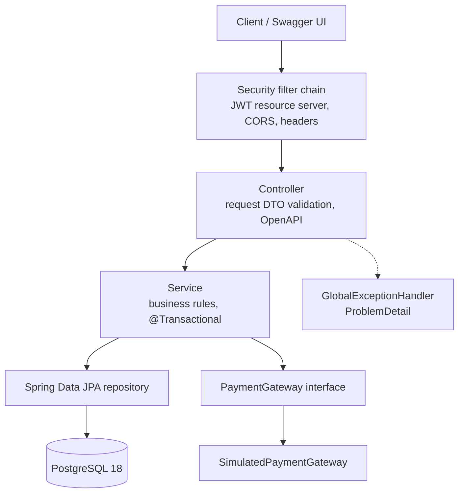
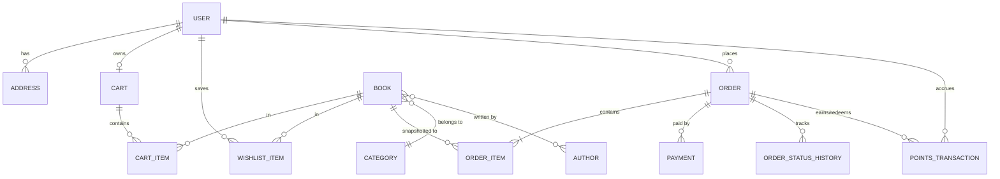
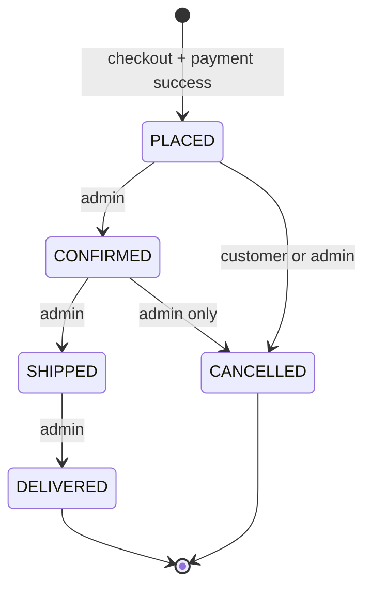

# BookWorm Backend: Design (Phase 0 baseline)

Status: Phases 0 and 1 are done and reviewed (committed). Phase 2 (authentication) is implemented and verified (`mvn verify`: 87 unit + 79 integration tests; see section 12) and awaits owner review. This document is the design that Phases 3-10 follow. All twelve design decisions below are confirmed by the project owner; the authentication choice remains a policy deviation that is **not approved** (section 7). Phase 3 starts only after the owner reviews Phase 2 and explicitly approves.

## 1. Decisions

| # | Decision | Status |
|---|---|---|
| 1 | Self-contained authentication: Spring Security, JWT, BCrypt. Registration and login. No Keycloak or external IdP. | Design confirmed by owner; deviation from the SAML/OIDC policy **not approved** (section 7) |
| 2 | All cart operations require an authenticated customer. No guest carts, no cart merging. | Confirmed |
| 3 | Minimal Admin API for books and catalogue data, protected by role-based authorization. Initial catalogue from seed data. | Confirmed |
| 4 | Order lifecycle: PLACED, CONFIRMED, SHIPPED, DELIVERED, CANCELLED, with validated transitions. | Confirmed |
| 5 | Loyalty: 1 point per Rs 100 spent; 100 points = Rs 10 discount; redemption capped at 20% of order value; rules configurable. | Confirmed |
| 6 | Physical store: customer shipping addresses, with a snapshot of the address stored on each order. | Confirmed |
| 7 | Java 21, PostgreSQL, latest stable compatible Spring Boot (verified: 4.1.2). | Confirmed |
| 8 | Points are credited when an order is DELIVERED, not at purchase. | Confirmed |
| 9 | Prices are tax-inclusive, no shipping fee, INR only. | Confirmed |
| 10 | Points earned are based on the amount actually paid, after the points discount. | Confirmed |
| 11 | Stock is held on the `books` table (no separate inventory table). | Confirmed |
| 12 | No refresh tokens (out of scope); short-lived access token (default 60 min). | Confirmed |

### Security policy deviation (decision 1)
The organisation's security rules require SAML or OpenID Connect for user authentication. The project owner chose self-contained login (Spring Security, JWT, BCrypt) with no external identity provider. That is a design choice; **it is not an approved policy exception, and this document does not claim that it is.** Status, compensating controls and the limitations of the design are in section 7 ("Authentication policy deviation: status and limitations").

## 2. Toolchain verification (done in Phase 0)

| Item | Version | Note |
|---|---|---|
| Spring Boot | 4.1.2 | Latest GA on Maven Central. `4.2.0-RC2` excluded (release candidate). |
| springdoc-openapi | 3.2.0 | Its parent is Boot 4.1.2. |
| Managed by Boot 4.1.2 | Spring Framework 7.0.10, Spring Security 7.1.2, Hibernate 7.4.13, PostgreSQL driver 42.7.14, Flyway 12.4.0, Jackson 3, JUnit 6.0.3 | Boot-managed versions are used as-is. |
| JWT | Spring Security Nimbus resource-server support | `jjwt` not used: it targets Jackson 2 and Boot 4 uses Jackson 3. |
| Java | 21 (Temurin 21.0.13) | The Boot parent defaults to 17; `java.version` is set to 21. |
| Maven | 3.10.1 | |
| PostgreSQL | 18.7, local, port 5432 | Docker is not available, so tests use a real local database, not Testcontainers or H2. |

## 3. Architecture

Single Spring Boot application, package-by-feature, strict layering. No microservices.



```
com.bookworm
 |- common     error handling, config, web filters, security config, paging
 |- auth       register, login, token issuing, lockout
 |- user       User, Address, profile
 |- catalogue  Book, Author, Category, search, related books, admin CRUD
 |- cart
 |- wishlist
 |- order      Order, OrderItem, status history, state machine, checkout
 |- payment    Payment, gateway interface, simulator
 |- loyalty    PointsTransaction, rules, calculator
```

Rules:
- `controller -> service -> repository`. Controllers never touch repositories.
- A feature uses another feature only through its service.
- Entities never leave the service layer. Requests and responses are Java records with hand-written mappers (no Lombok, no MapStruct).
- `order` orchestrates checkout (cart, stock, loyalty, payment) in one transaction.

| Concern | Decision |
|---|---|
| Money | `BigDecimal`, `NUMERIC(12,2)`, INR, `HALF_UP`. |
| Schema | Flyway versioned migrations; `ddl-auto=validate`. |
| Seed data | Separate Flyway location `db/seed`, dev profile only. Never in `db/migration`. |
| Concurrency | Atomic conditional stock update in id order, cart and order row locks, conditional points update. Full design: "Checkout, stock concurrency and idempotency" in section 4. |
| Idempotency | Required `Idempotency-Key` header on checkout; advisory lock plus unique (user, key) plus request fingerprint; a replay returns the original order. Full design in section 4. |
| Order numbers | `BW-YYYYMMDD-` + 6 random chars from `SecureRandom` (not enumerable). |
| Errors | One `@RestControllerAdvice`, RFC 9457 `ProblemDetail` with stable `code` and `traceId`. |
| Profiles | `dev`, `test`, `prod`. Secrets only from environment variables. |
| Binding | `server.address=127.0.0.1`. |
| Database safety | Only the application's Flyway migrations change schema. The assistant never creates, renames, drops or otherwise modifies a database or role on the owner's server without the owner's explicit approval; checks against the server are read-only. |

## 4. Domain model



| Entity (table) | Main fields | Constraints and notes |
|---|---|---|
| User (`users`) | id, email, passwordHash (BCrypt), firstName, lastName, phone, role (CUSTOMER/ADMIN), enabled, failedLoginAttempts, lockedUntil, pointsBalance, createdAt | Email unique, stored lowercase. Registration always yields CUSTOMER. First admin comes from environment variables, never a default password. |
| Address (`addresses`) | id, userId, recipientName, phone, line1, line2, city, state, postalCode, country, isDefault | One default per user. PIN is 6 digits. Max 10 per user. |
| Category | id, name, slug | Both unique. Flat. |
| Author | id, name | Created from names in the admin book request. |
| Book | id, isbn, title, description, price, publisher, publishedDate, coverUrl, categoryId, stockQuantity, active, version | ISBN unique. Authors via join table. Soft delete (`active=false`) keeps history valid. |
| Cart / CartItem | Cart: id, userId (unique), version, updatedAt. Item: cartId, bookId, quantity | Unique (cartId, bookId). No price stored; always read live. |
| WishlistItem | id, userId, bookId, addedAt | Unique (userId, bookId). |
| Order (`orders`) | id, orderNumber (unique), userId, status, subtotal, pointsRedeemed, pointsDiscount, total, pointsEarned, shipping address snapshot (embedded columns), idempotencyKey, requestFingerprint, version, createdAt, updatedAt | Unique (userId, idempotencyKey). `pointsEarned` is fixed at checkout and credited on DELIVERED. The snapshot copies address fields and has **no foreign key** to `addresses`. |
| OrderItem | id, orderId, bookId, isbnSnapshot, titleSnapshot, unitPrice, quantity, lineTotal | Immutable. |
| OrderStatusHistory | id, orderId, fromStatus, toStatus, changedBy, reason, changedAt | Audit trail. |
| Payment | id, orderId, amount, status (SUCCEEDED/REFUNDED), gatewayReference, createdAt | No card data stored. |
| PointsTransaction | id, userId, orderId, type (REDEEM/EARN/RESTORE), points (signed), createdAt | Append-only ledger. `users.pointsBalance` is a cached sum updated in the same transaction. Unique (orderId, type) so each happens once per order. `REVERSE_EARN` is reserved and not created (see Loyalty). |

Indexes: `pg_trgm` GIN on `books.title` and `authors.name` (Phase 1); B-tree on `books.category_id`, `orders(user_id, created_at)`, `orders(status)`.

### Order lifecycle



| From | Allowed to | Who |
|---|---|---|
| PLACED | CONFIRMED | Admin |
| PLACED | CANCELLED | Customer (owner) or admin |
| CONFIRMED | SHIPPED | Admin |
| CONFIRMED | CANCELLED | Admin only |
| SHIPPED | DELIVERED | Admin |
| DELIVERED, CANCELLED | none (terminal) | none |

Any other transition returns 409 `INVALID_STATUS_TRANSITION`. The transition table lives in the `OrderStatus` enum and is tested exhaustively.

Side effects: **cancel** restores stock and redeemed points and marks the payment REFUNDED. **Delivered** credits earned points (decision 8). Payment is not an order state: if simulated payment fails, the checkout transaction rolls back, no order is created, and the API returns 402 `PAYMENT_DECLINED`.

### Checkout, stock concurrency and idempotency

Goal: never oversell, never create a duplicate order, never leave a partially committed order. This is the design Phase 7 implements; Phase 1 contains none of it.

**Stock (prevents overselling)**
- Stock lives in `books.stock_quantity`, with `CHECK (stock_quantity >= 0)` as the last line of defence.
- Decrement is one atomic conditional statement per book, never read-then-write:
  `UPDATE books SET stock_quantity = stock_quantity - :q, version = version + 1 WHERE id = :id AND active = true AND stock_quantity >= :q`.
  PostgreSQL (default READ COMMITTED) locks the row on update. A concurrent buyer waits, then re-evaluates the `WHERE` clause against the committed value, so two buyers of the last copy cannot both succeed. Zero rows updated means 409 `INSUFFICIENT_STOCK` (or `BOOK_UNAVAILABLE` if the book became inactive).
- Books are always updated in ascending `id` order, so two checkouts with overlapping carts cannot deadlock. A deadlock or lock-timeout that still happens is mapped to 409 `CONCURRENT_UPDATE` and the client may retry.
- `/me/cart` and `/me/orders/preview` never reserve stock. They are advisory; checkout re-validates everything.
- Cancel restores stock with `stock_quantity = stock_quantity + :q` inside the cancel transaction.

**Checkout transaction (one `@Transactional` boundary, all-or-nothing)**
1. Require the `Idempotency-Key` header (1-64 characters from `A-Z a-z 0-9 _ -`); otherwise 400.
2. Take a transaction-scoped advisory lock on `hash(userId, key)` (`pg_advisory_xact_lock`) so concurrent requests with the same key run one after the other.
3. Look up an existing order for `(userId, key)`. If found, compare the request fingerprint: a SHA-256 hash of the request body fields `addressId`, `redeemPoints` and `paymentToken` (the cart contents are deliberately not part of it, because the cart is emptied by the first successful attempt). If it matches, return the stored order unchanged with HTTP 200 and an `Idempotent-Replay: true` header; if it differs, return 422 `IDEMPOTENCY_KEY_REUSED`. Only the hash is stored, never the raw payment token.
4. Lock the user's cart row (`SELECT ... FOR UPDATE`), which serialises two checkouts of the same cart that use different keys; the second then sees an empty cart and gets 422 `CART_EMPTY`.
5. Load the address (must belong to the caller, else 404) and copy its fields into the order snapshot.
6. Load the books in id order, require them active, read current prices, compute `subtotal`.
7. Validate and compute points redemption (see Loyalty).
8. Decrement stock per book (atomic statement above). Deduct points (conditional update above) and write the `REDEEM` ledger row.
9. Insert `orders` (status PLACED), `order_items`, and the first `order_status_history` row.
10. Call the `PaymentGateway` with the order number as reference. `tok_declined` raises 402 `PAYMENT_DECLINED`; `tok_error` raises 502 `PAYMENT_UNAVAILABLE`. Any exception rolls back steps 8-9 completely. On success insert the `payments` row (SUCCEEDED).
11. Delete the cart items. Commit.
12. After commit only: publish the confirmation event (a logged "notification sent" stub). A failure there cannot undo or alter the order.

**Why no partial order can be committed**
- Steps 8-11 are in a single database transaction. Declined payment, gateway failure, insufficient stock, a failed points deduction, any unexpected exception, or a crash before commit all roll back stock, points, order rows and payment together. The cart is untouched on failure.
- The unique constraint on `orders(user_id, idempotency_key)` is the backstop if the lock in step 2 were ever bypassed; a violation is handled by re-reading and returning the existing order.
- Keys are recorded only on success. Retrying a declined or failed checkout with the same key is therefore a fresh attempt, not a replay.
- If the client times out after the server committed, retrying with the same key returns the original order instead of creating a second one.

**Known limitations of this design (accepted for the capstone)**
- The simulated gateway runs in-process, so rolling back the database also "undoes" the payment. A real external gateway would not roll back; it would need a payment-intent record, the idempotency key passed to the gateway, and a reconciliation job. Holding row locks while calling a remote gateway would also be avoided. This is out of scope.
- The transaction has a timeout (default 10 seconds) so a slow request cannot hold stock row locks indefinitely.
- Lost updates on the cart itself are prevented by the row lock in step 4 and by `@Version` on `carts`; the cart endpoints return 409 `CONCURRENT_UPDATE` if two edits collide.

**Order status changes and cancel**
- Cancel and every admin status change first lock the order row (`SELECT ... FOR UPDATE`; `@Version` as a second guard), then check the transition table, then apply side effects (stock restore, points restore, payment refund, ledger rows) in the same transaction. Two concurrent cancels therefore serialise: the second sees CANCELLED and gets 409 `INVALID_STATUS_TRANSITION`, and stock and points are restored exactly once.

**Tests required in Phase 7/8 (exit criteria)**
- N threads buy the last copy: exactly one order, stock 0, never negative.
- Same key sent concurrently: exactly one order, all responses identical.
- Same key with a different body: 422 `IDEMPOTENCY_KEY_REUSED`.
- Declined payment, gateway failure, and a fault injected after the stock decrement: no order row, stock unchanged, points unchanged, cart intact.
- Two concurrent cancels: stock and points restored once.
- Two checkouts with overlapping carts in opposite order: no deadlock failure.

### Loyalty rules (configurable)

```yaml
bookworm.loyalty:
  earn-points: 1
  earn-per-amount: 100.00
  redeem-points-unit: 100
  redeem-value-unit: 10.00
  max-redeem-percent: 20
```

All arithmetic uses `BigDecimal` (money, scale 2) and `long` (points). No `double` or `float` anywhere in loyalty or pricing code. The rules are read from configuration and validated at startup (all values positive, `max-redeem-percent` between 0 and 100); an invalid configuration stops the application.

**Definitions**
- `subtotal` = sum of `unitPrice x quantity` over the order lines (exact at scale 2). Because prices are tax-inclusive and there is no shipping fee (decisions 9), `subtotal` is the "order value" used for the 20% cap.
- `pointValue` = `redeem-value-unit / redeem-points-unit` = Rs 0.10 per point with the defaults.
- `total` = `subtotal - pointsDiscount` = the amount actually paid.

**Redemption (at checkout, and in `/me/orders/preview`)**
1. `maxDiscount = subtotal x max-redeem-percent / 100`, rounded **DOWN** to 2 decimals (paise).
2. `maxPointsByCap = floor(maxDiscount / pointValue)`.
3. `maxRedeemablePoints = min(user.pointsBalance, maxPointsByCap)`.
4. `redeemPoints` must be a whole number, `>= 0` and `<= maxRedeemablePoints`. Any whole number is valid; it need not be a multiple of 100 (interpretation: 100 points = Rs 10 means 1 point = Rs 0.10).
5. `pointsDiscount = redeemPoints x pointValue` (exact at scale 2 with the defaults; for other configurations the result is rounded **DOWN** to 2 decimals so the customer is never given more discount than the points are worth).
6. A request above `maxRedeemablePoints` returns 422 `POINTS_LIMIT_EXCEEDED` with the allowed maximum in the response. It is never silently clamped. Until Phase 9 ships, the maximum is 0.
7. Because the cap is 20%, `total` is always at least 80% of `subtotal`, so a payment of zero is impossible.

**Earning**
- `pointsEarned = floor(total / earn-per-amount) x earn-points` (integer division of the amount actually paid, after the points discount). The discounted portion earns nothing.
- `pointsEarned` is calculated at checkout and **stored on the order**. It is credited as an `EARN` ledger row only when the order reaches DELIVERED, using the stored value, so a later configuration change cannot alter an existing order.
- If `pointsEarned` is 0, no ledger row is written.

**Ledger and balance**
- `points_transactions` is append-only; points are signed (`REDEEM` negative, `EARN` and `RESTORE` positive). `users.points_balance` is a cache updated in the same transaction as the ledger row, and an invariant (tested): `points_balance = SUM(ledger.points)` for every user.
- `points_balance` has `CHECK (points_balance >= 0)`. Deduction uses `UPDATE users SET points_balance = points_balance - :p WHERE id = :id AND points_balance >= :p`; zero rows updated means the balance changed concurrently and the checkout fails with 422 `POINTS_LIMIT_EXCEEDED` and rolls back.
- A partial unique index on `(order_id, type)` for types `REDEEM`, `EARN` and `RESTORE` makes each of them happen at most once per order, even if two requests race.

**Cancellation and reversal**

| Event | Ledger effect | Money effect |
|---|---|---|
| Checkout with redemption | `REDEEM` (negative) | Customer pays `total` |
| Cancel from PLACED or CONFIRMED | `RESTORE` (positive) for exactly the points redeemed on that order | Payment marked REFUNDED for `total` |
| Cancel an order with no redemption | none | Payment REFUNDED |
| DELIVERED | `EARN` (positive) using the stored `pointsEarned` | none |
| Cancel after DELIVERED | not allowed (DELIVERED is terminal, 409 `INVALID_STATUS_TRANSITION`) | none |

- Points are credited only on DELIVERED, and a cancelled order can never reach DELIVERED. Therefore **no earned points exist to reverse on cancellation**, and under the confirmed lifecycle no reversal of earned points happens. The `REVERSE_EARN` ledger type is reserved for a possible future return or refund-after-delivery feature and is **never written in this scope** (it is not created in the schema's allowed values until such a feature is designed).
- Restore is exact and one-time: it returns the points redeemed on that order, whatever the configuration is now, and the unique index above blocks a second restore.
- The cancel code locks the order row first (see "Checkout, stock concurrency and idempotency"), so two concurrent cancels cannot both restore points or stock.

**Worked examples (defaults)**

| Subtotal | Balance | Requested | maxDiscount | maxRedeemable | Discount | Total paid | Earned on DELIVERED |
|---|---|---|---|---|---|---|---|
| 1000.00 | 500 | 500 | 200.00 | min(500, 2000) = 500 | 50.00 | 950.00 | 9 |
| 999.99 | 5000 | 1999 | 199.99 (199.998 rounded down) | min(5000, 1999) = 1999 | 199.90 | 800.09 | 8 |
| 99.00 | 1000 | 198 | 19.80 | min(1000, 198) = 198 | 19.80 | 79.20 | 0 |
| 250.00 | 40 | 0 | 50.00 | min(40, 500) = 40 | 0.00 | 250.00 | 2 |
| 1000.00 | 500 | 501 | 200.00 | 500 | rejected | n/a | 422 `POINTS_LIMIT_EXCEEDED` |

Cancel example: the first row's order is cancelled while PLACED. Ledger gets `RESTORE +500`, the balance returns to 500, the payment of Rs 950.00 is marked REFUNDED, and no points were ever earned, so nothing is reversed. Each row above becomes a unit test in Phase 9.

## 5. API specification

Base path `/api/v1`. JSON only. `/me/**` takes the user from the validated token, never from the URL. Lists are paginated (`page`, `size` <= 100, `sort` from an allowlist).

**Auth (public)**

| Method | Path | Purpose |
|---|---|---|
| POST | `/auth/register` | `{email, password, firstName, lastName, phone?}` -> 201 profile |
| POST | `/auth/login` | `{email, password}` -> `{accessToken, tokenType, expiresIn}` |

**Profile and addresses (authenticated)**

| Method | Path | Purpose |
|---|---|---|
| GET, PUT | `/me` | View or update profile |
| POST | `/me/password` | Change password (needs current password) |
| GET, POST | `/me/addresses` | List or add |
| GET, PUT, DELETE | `/me/addresses/{id}` | Manage an address |
| POST | `/me/addresses/{id}/default` | Set default |

**Catalogue (public)**

| Method | Path | Purpose |
|---|---|---|
| GET | `/books?q=&category=&page=&size=&sort=` | Search by title or author; filter by category slug; active books only |
| GET | `/books/{id}` | Details with authors, category, availability |
| GET | `/books/{id}/related?limit=8` | Same author first, then same category, excluding the book |
| GET | `/categories` | List categories |

**Admin catalogue (ADMIN)**

| Method | Path | Purpose |
|---|---|---|
| POST | `/admin/books` | Create |
| PUT | `/admin/books/{id}` | Update |
| DELETE | `/admin/books/{id}` | Soft delete |
| PATCH | `/admin/books/{id}/stock` | Set stock `{quantity}` |
| GET | `/admin/books?includeInactive=true` | List including inactive |
| POST, PUT, DELETE | `/admin/categories`, `/admin/categories/{id}` | Manage categories; delete blocked if books use it |

**Cart (authenticated)**

| Method | Path | Purpose |
|---|---|---|
| GET | `/me/cart` | Items, line totals, subtotal, item count |
| POST | `/me/cart/items` | `{bookId, quantity}`; an existing book increases its quantity |
| PUT | `/me/cart/items/{bookId}` | Set quantity |
| DELETE | `/me/cart/items/{bookId}` | Remove item |
| DELETE | `/me/cart` | Clear |

**Wishlist (authenticated)**

| Method | Path | Purpose |
|---|---|---|
| GET | `/me/wishlist` | List |
| PUT | `/me/wishlist/{bookId}` | Add (idempotent) |
| DELETE | `/me/wishlist/{bookId}` | Remove |
| POST | `/me/wishlist/{bookId}/move-to-cart` | Move to cart |

**Orders, payment, loyalty (authenticated)**

| Method | Path | Purpose |
|---|---|---|
| POST | `/me/orders/preview` | `{addressId, redeemPoints?}` -> totals, `maxRedeemablePoints`, points to be earned. No side effects. |
| POST | `/me/orders` | Checkout. Body `{addressId, redeemPoints?, paymentToken}`; header `Idempotency-Key`. 201 with the order (the confirmation). |
| GET | `/me/orders` | History, newest first, optional `status` filter |
| GET | `/me/orders/{orderNumber}` | Details, items, address snapshot, status history |
| POST | `/me/orders/{orderNumber}/cancel` | Customer cancel (PLACED only) |
| GET | `/me/points` | Balance, `maxRedeemable` hint, recent ledger entries |

**Admin orders (ADMIN)**

| Method | Path | Purpose |
|---|---|---|
| GET | `/admin/orders?status=&page=` | List all orders |
| GET | `/admin/orders/{orderNumber}` | Details |
| PATCH | `/admin/orders/{orderNumber}/status` | `{status, reason?}`; applies the transition rules |

Simulated payment tokens: `tok_success` approves, `tok_declined` returns 402, `tok_error` simulates gateway failure (502); anything else returns 400. The API never accepts card numbers.

OpenAPI: `/v3/api-docs` and `/swagger-ui.html` are on in `dev` and `test`, off by default and in `prod`. Swagger gets a Bearer scheme.

## 6. Validation and error handling

| Area | Rules |
|---|---|
| Registration | Email format, max 254, unique (409). Password >= 12 characters and <= 72 bytes (BCrypt limit). Names 1-100 characters. |
| Address | Required fields; PIN 6 digits; phone 10 digits; max 10 per user. |
| Search | `q` <= 100 characters; `%` and `_` escaped; parameterized queries. |
| Paging | `size` 1-100; `sort` from an allowlist. |
| Admin book | ISBN-13/10 with checksum; price > 0; stock >= 0; title required; category must exist; max 10 authors. |
| Cart | Quantity 1-10 per line; book active; quantity <= stock. |
| Checkout | Cart not empty; address owned by caller; stock re-checked; prices re-read; `redeemPoints` >= 0, <= balance and within the 20% cap; `Idempotency-Key` required. |
| Order status | Transition must be allowed by the table above. |
| Path IDs | Type-checked; malformed ID returns 400. |

| Condition | Status | `code` |
|---|---|---|
| Invalid body or parameter | 400 | `VALIDATION_FAILED` (field errors listed), `MALFORMED_REQUEST` |
| Unauthenticated / bad credentials | 401 | `UNAUTHENTICATED`, `INVALID_CREDENTIALS` |
| Wrong role | 403 | `ACCESS_DENIED` |
| Not found, or another user's resource | 404 | `NOT_FOUND` |
| Duplicate email, ISBN, slug | 409 | `DUPLICATE_RESOURCE` |
| Insufficient stock | 409 | `INSUFFICIENT_STOCK` |
| Illegal status transition | 409 | `INVALID_STATUS_TRANSITION` |
| Concurrent modification | 409 | `CONCURRENT_UPDATE` |
| Empty cart, points over limit | 422 | `CART_EMPTY`, `POINTS_LIMIT_EXCEEDED` |
| Payment declined | 402 | `PAYMENT_DECLINED` |
| Payment gateway failure | 502 | `PAYMENT_UNAVAILABLE` |
| Locked account | 423 | `ACCOUNT_LOCKED` |
| Anything unexpected | 500 | `INTERNAL_ERROR` (generic message; detail only in server logs) |

Login failures return the same message for a wrong email or password. Another user's order returns 404, not 403. Codes implemented in Phase 0: `VALIDATION_FAILED`, `MALFORMED_REQUEST`, `NOT_FOUND`, `METHOD_NOT_ALLOWED`, `NOT_ACCEPTABLE`, `UNSUPPORTED_MEDIA_TYPE`, `DUPLICATE_RESOURCE`, `DATA_INTEGRITY_VIOLATION`, `CONCURRENT_UPDATE`, `REQUEST_FAILED`, `INTERNAL_ERROR`; the rest are added with the phase that needs them.

Additional codes introduced by the checkout design (added in the phase that needs them): `BOOK_UNAVAILABLE` (409, a book in the cart is inactive or removed) and `IDEMPOTENCY_KEY_REUSED` (422, same key sent with a different request body). A missing `Idempotency-Key` header is a 400. Phase 0's handler maps only optimistic-lock failures to `CONCURRENT_UPDATE`; Phase 7 extends it to also map pessimistic-lock, deadlock and serialization failures to 409 `CONCURRENT_UPDATE`.

## 7. Security

- Passwords: BCrypt via `DelegatingPasswordEncoder`; never returned or logged.
- Tokens: signed JWT (HS256, secret from environment, at least 32 bytes; startup fails otherwise). Claims: `sub` (user id), `role`, `iss`, `iat`, `exp`. Signature, issuer and expiry validated on every request.
- Brute force: 5 failed logins lock the account for 15 minutes (counter in the database). A per-IP rate limit would still be needed in production.
- Authorization: deny by default; `/admin/**` requires ROLE_ADMIN; `/me/**` always scoped by the token's user id (prevents IDOR).
- Admin bootstrap: `BOOKWORM_ADMIN_EMAIL` and `BOOKWORM_ADMIN_PASSWORD`; nothing is created if unset; no default credentials.
- Sessions: stateless; CSRF disabled only because tokens travel in the `Authorization` header, never in cookies.
- Input: explicit request DTOs (no mass assignment); parameterized queries.
- Network: bind to `127.0.0.1`; TLS 1.2+ for any non-local deployment; no wildcard CORS; security headers.
- Actuator exposes only `health` and `info`. Swagger is off in `prod`.
- Logging: structured, with correlation id; never log passwords, tokens, PII or payment data. Security events are logged.
- Secrets: environment variables only; `.gitignore` excludes `.env*` and build output.
- Supply chain: Boot-managed versions; run a dependency vulnerability scan (Mend) in CI. Not runnable from this environment.
- Containers (optional): Red Hat UBI minimal from `registry.redhat.io`, non-root, read-only filesystem.

### Authentication policy deviation: status and limitations

**Status: policy deviation, not approved.** The organisation's security rules require SAML or OpenID Connect for user authentication. The project owner has chosen self-contained authentication (Spring Security, JWT, BCrypt, no external identity provider). That is the owner's design choice. It is **not** a recorded approval of an exception, and this document does not claim one. Until whoever governs the security policy for this project approves it, treat it as an open deviation. If it is rejected, the migration path is to replace the token issuer with an OIDC provider; the APIs already validate JWTs as a resource server, so the change is concentrated in the `auth` module.

Compensating controls: BCrypt hashing, signed short-lived JWTs validated on every request, account lockout, deny-by-default authorization, no default credentials, secrets only from the environment.

Limitations of this design (accepted as designed; not all are mitigated):
1. **No SAML/OIDC.** This application stores and verifies credentials itself, so it becomes a credential store and an attack target.
2. **No MFA.** The policy requires MFA for sensitive operations; it is not implemented for checkout or admin actions.
3. **Tokens cannot be revoked.** There is no logout or token denylist, and a password change does not invalidate tokens already issued: they stay valid until `exp` (60 minutes). Deleting or disabling a user and changing a role take effect on the next request, because every authenticated request reloads the user from the database (`CurrentUserJwtConverter`) and takes the authority from the current database role. That costs one indexed query per authenticated request.
4. **Shared HS256 secret.** Anyone holding the secret can mint tokens, including ADMIN tokens. Rotating it invalidates all tokens. Asymmetric signing would be stronger but is not planned.
5. **No refresh tokens** (decision 12): users log in again when the token expires.
6. **Lockout is per account** (5 failures, 15 minutes). An attacker can deliberately lock a victim out (denial of service against a known email). There is no per-IP rate limit, no CAPTCHA and no breached-password check. A locked account answers 423 `ACCOUNT_LOCKED`, which also confirms that the email exists.
7. **No email verification, password reset or account recovery.** Registration is open to anyone.
8. **Account enumeration via registration.** Login returns the same error for a wrong email or password, but registering an existing email returns 409, which reveals that the email is registered.
9. **Client-side token storage is outside this backend's control.** Tokens travel in the `Authorization` header and never in cookies, which is why CSRF protection is disabled.
10. **No TLS in the application.** TLS 1.2+ must be provided before any non-local deployment.

## 8. Phase plan

Each phase ends with a stop for owner review. The next phase does not start without approval.

| Phase | Scope | Exit criteria |
|---|---|---|
| 0. Foundation (**done**) | Maven project, `.gitignore`, profiles, DB config, Flyway baseline, error handling, OpenAPI config, test setup, `AGENTS.md` | `mvn verify` passes (14/14); app context starts; Swagger/OpenAPI served in test profile; bad requests return `ProblemDetail`. |
| 1. Catalogue (read only) (**done, reviewed**) | Book, Author, Category tables and read-only entities; dev seed data (~30 books); `GET /books` (search, category filter, paging), `GET /books/{id}`, `GET /books/{id}/related`, `GET /categories`; trigram indexes. **No admin write endpoints and no checkout** (see "Phase 1 scope"). | Search, filter, details and related demonstrable in Swagger; tests cover wildcard escaping and related ordering; the OpenAPI document contains only GET operations. |
| 2. Authentication (**implemented, awaiting owner review**) | User, register, login, JWT validation, BCrypt, lockout, roles, admin bootstrap, `/me`, change password | 401, 403 and lockout tests pass; Swagger Authorize works. |
| 3. Admin catalogue | Admin book and category CRUD, soft delete, stock update | Customer gets 403; admin changes visible publicly; duplicate ISBN returns 409. |
| 4. Addresses | Address CRUD, default address | Cross-user access returns 404; only one default. |
| 5. Cart | Cart and items, totals, stock-aware validation | Totals exact to the paisa; concurrency and ownership tests pass. |
| 6. Wishlist | Idempotent add/remove, move-to-cart | Wishlist and cart integration work. |
| 7. Checkout and payment | Order, OrderItem, address snapshot, pricing service, payment gateway interface and simulator, atomic checkout, idempotency, history, preview | Decline and gateway failure leave no order and no stock change; replay returns the same order; later address edits do not alter the order. |
| 8. Order lifecycle | State machine, customer cancel, admin status endpoint, history, stock and payment side effects | Exhaustive transition test; cancel restores stock; terminal states enforced. |
| 9. Loyalty | Ledger, configurable rules, redeem at checkout, earn on delivery, restore on cancel, `/me/points` | The worked example is a test; cap, balance and rounding edge cases covered. |
| 10. Hardening and delivery | Header/CORS review, log review, security test pass, README and OpenAPI polish, demo script | Section 7 satisfied and documented. |

### Phase 1 scope (catalogue read only)

**In scope**
- Flyway versioned migration `V2` (in `db/migration`) creating the `pg_trgm` extension and the tables `categories`, `authors`, `books` and `book_authors`, with: unique ISBN, unique category name and slug, `CHECK (price > 0)`, `CHECK (stock_quantity >= 0)`, and the indexes from section 4 (trigram GIN on `books.title` and `authors.name`, B-tree on `books.category_id`).
- Four read-only endpoints:
  - `GET /api/v1/books?q=&category=&page=&size=&sort=`: case-insensitive substring search on title and author name; `q` at most 100 characters with `%`, `_` and `\` escaped; `category` is a category slug; `size` 1-100; `sort` limited to an allowlist (`title`, `price`, `publishedDate`), default `title` ascending; active books only.
  - `GET /api/v1/books/{id}`: details with authors and category; inactive or unknown id returns 404. Availability is exposed as `inStock` only; the exact stock count is not returned publicly.
  - `GET /api/v1/books/{id}/related?limit=`: `limit` 1-20, default 8; books sharing an author first, then books in the same category; the book itself and inactive books excluded; ties broken by title then id, so results are deterministic.
  - `GET /api/v1/categories`.
- Development seed data (~30 books with several categories and authors) as a **repeatable** migration `R__seed_catalogue.sql` in `db/seed`, written idempotently (`ON CONFLICT DO NOTHING`). It is loaded only when the `dev` profile adds `classpath:db/seed` to `spring.flyway.locations`; the default and `prod` profiles never include it, and the `test` profile does not load it (tests create their own fixtures). It is repeatable rather than versioned because a versioned seed number would collide with later versioned migrations in a dev database.
- Tests: service and repository tests for search, escaping, filter, paging, related ordering; controller tests for validation errors; an integration test against `bookworm_test`.

**Out of scope (must not be implemented in Phase 1)**
- Any `POST`, `PUT`, `PATCH` or `DELETE` mapping, including every `/admin/**` endpoint. The only writes to the catalogue tables are Flyway migrations (schema and dev seed).
- Any code that changes stock quantity.
- Cart, wishlist, checkout, orders, payment, loyalty, addresses.
- Authentication, users, JWT and the Spring Security dependency (Phase 2).

**Consequences to be aware of**
- Until Phase 2 there is no security filter chain. Phase 1 exposes only public read-only catalogue endpoints, which are public by design, plus `health` and `info`, and Swagger in `dev`/`test`.
- Flyway applies migrations automatically to whichever database the application or test run connects to. `mvn verify` will therefore apply `V2` to `bookworm_test` (the same way `V1` was applied in Phase 0), and the owner's first `dev` start will apply `V2` and the seed to `bookworm_db`. These are schema changes made by the application's own migrations; they need the owner's approval of Phase 1, and no other database change is made.
- `application-dev.yml` must set `spring.flyway.locations` to both `classpath:db/migration` and `classpath:db/seed`; setting only the seed location would skip the schema migrations.

**Exit criteria**: the endpoints above work in Swagger against seeded data; wildcard characters in `q` match literally; related-book ordering is covered by a test; `mvn verify` passes; the OpenAPI document contains no non-GET operation.

## 9. Testing strategy

- Unit tests (JUnit, Mockito) for services, state machine and loyalty calculation.
- Controller tests with `@WebMvcTest` and Spring Security test support.
- Integration tests (`*IT`, `@SpringBootTest`) against the real PostgreSQL `bookworm_test` database. No H2.
- Commands are recorded in `AGENTS.md`.

## 10. Phase 0 implementation summary

| Area | Files |
|---|---|
| Build | `pom.xml` (Boot 4.1.2, Java 21, springdoc 3.2.0, Failsafe, Mockito agent), `.gitignore` |
| Config | `application.yml`, `application-dev.yml`, `application-prod.yml`, `src/test/resources/application-test.yml` |
| Database | `db/migration/V1__baseline.sql` (placeholder; no tables yet) |
| Error handling | `common/error/ErrorCode`, `ApiException`, `GlobalExceptionHandler`; `common/web/TraceIdFilter` |
| OpenAPI | `common/config/OpenApiConfig` |
| Tests | `GlobalExceptionHandlerTest` (9 unit tests), `BookwormApplicationIT` (5 integration tests) |

Known limitations after Phase 0: no domain tables, no security filter chain yet (all endpoints are open until Phase 2), and the app has not yet been started interactively against `bookworm_db`. The database connection itself was re-checked read-only with `psql` after the owner removed the stray TAB: `bookworm_db` now resolves (11 characters) and contains 0 tables.

## 11. Phase 1 implementation summary (catalogue, read only)

| Area | Files |
|---|---|
| Migration | `db/migration/V2__catalogue_schema.sql`: `pg_trgm`, tables `categories`, `authors`, `books`, `book_authors`; unique name/slug/ISBN; CHECKs on price > 0, stock >= 0, ISBN and slug format; trigram GIN indexes on `lower(books.title)` and `lower(authors.name)`; B-tree on `books.category_id` and `book_authors.author_id`. Schema only, no data. |
| Dev seed | `db/seed/R__seed_catalogue.sql`: 6 categories, 24 authors, 31 books (1 inactive on purpose), 32 author links. Insert-only, idempotent, never overwrites existing rows or re-links authors of a book that already has some. Loaded only by `application-dev.yml`. |
| Domain | `catalogue/Book`, `Author`, `Category` (read-only `@Immutable` entities); `BookRepository`, `CategoryRepository` |
| Service / DTOs | `CatalogueService` (read-only transactions); records `BookSummaryResponse`, `BookDetailResponse`, `AuthorResponse`, `CategoryResponse`; `common/web/PageResponse`; `common/persistence/LikePatterns` |
| API | `CatalogueController`: `GET /api/v1/books`, `GET /api/v1/books/{id}`, `GET /api/v1/books/{id}/related`, `GET /api/v1/categories` |
| Config | `application-dev.yml` now lists both Flyway locations |
| Tests | `LikePatternsTest` (5), `CatalogueServiceTest` (9), `CatalogueControllerTest` (11), `CatalogueIT` (19, against `bookworm_test`) |

Behaviour notes: search is a case-insensitive substring match on title or author name; `%`, `_` and `\` in `q` match literally; sort is limited to `title`, `price`, `publishedDate` (default `title`, ascending) with `id` as a tie-breaker so paging is stable; related books are same-author first, then same-category, ordered by title then id, excluding the book itself and inactive books. Public responses carry `inStock` and never the stock count.

Verification (2026-11-19): `mvn verify` BUILD SUCCESS, 34 unit + 24 integration tests, 0 failures. V2 applied to `bookworm_test` by the test run and to `bookworm_db` by a `dev` start, which also ran the seed. A live run on `127.0.0.1:8080` confirmed search, author search, category filter and sort, literal `%`, inactive-book hiding, details, related ordering, error codes (404, 400 `MALFORMED_REQUEST`, 400 `VALIDATION_FAILED`), 405 for POST/PUT/PATCH/DELETE, Swagger UI, and an OpenAPI document with exactly four GET operations. A static scan found no write mappings, no `@Modifying` queries, no stock writes and no Spring Security dependency in the main code.

Known limitations after Phase 1:
- No security filter chain: all catalogue endpoints, `health`, `info` and Swagger (in dev/test) are open until Phase 2. The catalogue is public by design.
- The application connects to PostgreSQL as the `postgres` superuser, which is acceptable only for local development; a least-privilege role is not yet created.
- Search uses `LIKE '%text%'` on `lower(column)`. Trigram indexes serve this for queries of 3 or more characters; shorter queries may scan the table. Not an issue at 31 rows; revisit if the catalogue grows large.
- The related-books query for authors uses a subquery per request; fine at this scale and covered by tests.
- `V2` created the `pg_trgm` extension, which required a database role allowed to create extensions (the `postgres` superuser here). A least-privilege deployment role cannot do this and would need the extension created in advance by an administrator.

## 12. Phase 2 implementation summary (authentication)

| Area | Files |
|---|---|
| Migration | `db/migration/V3__users.sql`: table `users` (identity PK, unique lowercase email, BCrypt hash, names, optional 10-digit phone, role, enabled, failed attempts, `locked_until`, version, timestamps) with CHECKs on lowercase email, role (`CUSTOMER`/`ADMIN`), phone format and non-negative attempts. Schema only; no rows, no default credentials. |
| Config | `application.yml` block `bookworm.security.*` (BCrypt strength 12, JWT secret/issuer/ttl, lockout, optional bootstrap admin); `pom.xml` adds `spring-boot-starter-security`, `spring-boot-starter-oauth2-resource-server` and the test-scoped `spring-boot-starter-security-test`; `OpenApiConfig` adds the `bearerAuth` scheme. |
| Security | `common/security/`: `SecurityConfig` (stateless, deny by default, CSRF off because no cookies), `TokenConfig` (HS256 encoder/decoder, issuer and expiry validation, startup failure for a missing, non-base64 or under 32-byte secret), `CurrentUserJwtConverter` (per-request database check), `PasswordPolicy`, `Emails`, problem-detail entry point and access-denied handler. |
| Auth | `auth/`: `AuthController`, `AuthService`, `LoginAttemptService` (atomic counter update, `REQUIRES_NEW`), `JwtTokenService`, `AdminBootstrap`, request/response records. |
| User | `user/`: `User`, `Role`, `UserRepository`, `UserService`, `MeController`, `ProfileResponse`, `UpdateProfileRequest`. |
| Errors | `ErrorCode` gains `UNAUTHENTICATED`, `INVALID_CREDENTIALS`, `ACCESS_DENIED`, `ACCOUNT_LOCKED` (423); `ApiException` can carry field problems; `GlobalExceptionHandler` handles field errors, `AccessDeniedException` and `AuthenticationException`. |
| Endpoints | `POST /api/v1/auth/register` (201), `POST /api/v1/auth/login`, `GET` and `PUT /api/v1/me`, `POST /api/v1/me/password`. The catalogue stays public. `/api/v1/admin/**` requires ADMIN but no admin endpoint exists yet (Phase 3). |
| Tests | Unit: `PasswordPolicyTest`, `EmailsTest`, `TokenConfigTest`, `AuthServiceTest`, `AdminBootstrapTest`, plus updated catalogue/handler tests (87 unit tests in total). Integration against `bookworm_test`: `RegistrationAndLoginIT` (13), `LockoutIT` (9), `ProfileAndPasswordIT` (8), `AdminBootstrapIT` (4), `JwtSecurityIT` (20), `BookwormApplicationIT` (6), `CatalogueIT` (19) = 79. |

Behaviour notes:
- Register lower-cases the email and always creates a CUSTOMER. Password: at least 12 characters and at most 72 UTF-8 bytes (BCrypt limit).
- Login answers an identical 401 `INVALID_CREDENTIALS` for an unknown email, a wrong password and a disabled account; an unknown email still runs a BCrypt check against a dummy hash to keep timing similar. The token is HS256 with claims `sub`, `role`, `iss=bookworm`, `iat`, `exp`; lifetime 60 minutes, no clock skew, Bearer header only.
- **Per-request check.** Every authenticated request validates the signature, issuer and expiry, then loads the user by id. A deleted or disabled user is rejected on the next request even with a valid token, and the authority comes from the current database role, so a promotion or demotion applies on the next request.
- Lockout: 5 consecutive failures lock the account for 15 minutes (423 `ACCOUNT_LOCKED`). The counter update is atomic and committed in its own transaction so it survives the failed login. A wrong current password on a password change is a 400 field error and counts towards lockout.
- `/me` endpoints derive the user only from the token; there is no user id in the URL.
- Admin bootstrap: only when both `BOOKWORM_ADMIN_EMAIL` and `BOOKWORM_ADMIN_PASSWORD` are set. It never promotes an existing account, never changes an existing account's credentials (insert uses `ON CONFLICT (email) DO NOTHING`, after an existence check), is idempotent and logs no credentials.
- Required environment: `BOOKWORM_JWT_SECRET` (base64 of at least 32 random bytes) in addition to the database variables. Tests generate their own secret and force the bootstrap variables empty.
- Nimbus is the Spring Security-managed 10.9.1; the newer 10.10 is deliberately not forced without a compatibility and security review.

Limitations after Phase 2 (see also section 7):
- The authentication design is a **policy deviation that is not approved**. It is not an approved exception.
- A password change does not revoke tokens already issued (valid up to 60 minutes); there is no logout or denylist. Disable, delete and role change do take effect on the next request.
- The HS256 secret is shared by issuer and validator; anyone holding it can mint ADMIN tokens, and rotation invalidates every token.
- Lockout can be abused to lock a known account out; there is no per-IP rate limit. A 423 response confirms that the email exists, as does the 409 on duplicate registration.
- No MFA, email verification, password reset, refresh tokens or TLS in the application.
- The per-request user lookup adds one indexed database query to every authenticated request.
- The application still connects as the `postgres` superuser (local development only).
- `V3` has been applied to `bookworm_test` by the test run (the table is empty after the tests). It has not yet been applied to `bookworm_db`; the first normal start of the application will apply it through Flyway.

### Phase 2 review findings (tracked, deliberately not fixed in Phase 2)

No critical or high-risk findings. The items below were found in the final read-only review and are open follow-ups. M1 and M2 must be resolved before any shared or non-local deployment.

Medium:
- **M1. Lockout bypass by in-flight concurrent guesses.** `AuthService.login` and `changePassword` check the lock against a snapshot, then run BCrypt. Requests already past the check can still succeed after the account locks, and `clearLoginFailures` then clears the lock unconditionally. Fix direction: make the success reset conditional on the lock state in SQL, or re-check the lock after BCrypt.
- **M2. Timing oracle for account enumeration.** A password over 72 UTF-8 bytes skips BCrypt for an existing email but not for an unknown one (dummy hash), so the two are distinguishable by response time. Fix direction: run a dummy match in that branch too.
- **M3. Registration squatting of the admin email.** Registration is open and unverified, so the bootstrap admin email can be registered first; bootstrap then refuses to promote it and logs only at INFO. Fix direction: log at WARN and document an operator runbook step.

Low:
- L1. The data-integrity and catch-all handlers log full exceptions; a PostgreSQL CHECK failure detail can include the failing row (email, hash).
- L2. `UserService.registerCustomer` maps any `DataIntegrityViolationException` to 409 "email exists".
- L3. Password change does not apply the "must not equal the email" rule.
- L4. Email is normalised before validation (for example the Kelvin sign U+212A lower-cases to ASCII `k`); the local part allows leading, trailing and consecutive dots.
- L5. HEAD and OPTIONS on public catalogue endpoints require authentication (fail-closed); revisit with CORS in Phase 10.
- L6. No explicit `@Size` limit on password fields or request-body size limit.
- L7. No BCrypt hash upgrade path and no JWT `kid` (single signing key).
- L8. Security log lines carry no client IP, and every rejected request logs a WARN line.
- L9. A database failure inside `CurrentUserJwtConverter` surfaces as a 500 rather than a problem+json 401 (still fail-closed).
- L10. Names accept any characters; escape on output when HTML rendering is added.
- L11. The bootstrap admin has a generic name and no forced password change; remove `BOOKWORM_ADMIN_PASSWORD` from the environment after first start.

Missing tests to add with the fixes: concurrent duplicate registration; a concurrent burst including the correct password during lockout (M1); known versus unknown email timing for over-long passwords (M2); 72 versus 73 byte and multi-byte password boundaries; JWT with future `nbf` and odd subjects (`+5`, whitespace); disabled user using an existing token for password change and profile update; actuator endpoints other than `health` and `info`, and docs hidden outside dev/test; HEAD and OPTIONS on public endpoints; log-capture test that no password, token, hash or email is logged; new password equal to the email on change; locked account attempting a password change; oversized request bodies.
